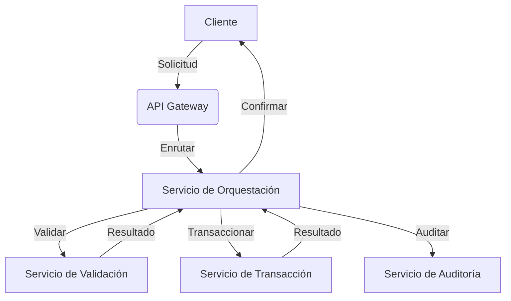
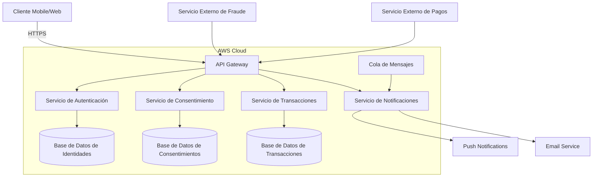

# Prompt para Mejorar el Codigo Base

Copia y pega el contenido del bloque de abajo en un asistente de IA (Claude, ChatGPT)
para obtener un ZIP con el proyecto completo y arrancable.

Si preferis trabajar en tu editor con un agente local (Claude Code, Cursor, Copilot), usa `AGENTS.md` en vez de este archivo: dice lo mismo pero para que escriba los archivos en disco.

## Las dos reglas que no se negocian

1. **Completa el boilerplate.** Todo lo que el proyecto necesita para compilar y arrancar: manifiesto de dependencias, punto de entrada, configuracion, capa de interfaz, y las capas del patron arquitectonico declarado. Eso es andamiaje y es tu trabajo.
2. **NO resuelvas el reto.** Los entregables de las fases son el trabajo de la persona. El hueco pedagogico se deja como esta: el proyecto arranca, pero lo que el reto pide implementar NO esta implementado.

Dicho de otra forma: si algo impide compilar, arreglalo. Si algo es logica de negocio incompleta, validaciones ausentes, un secreto hardcodeado o un patron mejorable, dejalo exactamente como esta — es lo que la persona tiene que encontrar.

## Superficie de practica — NO resuelvas

Estos archivos SON el ejercicio de la persona. No los implementes; deja stubs.

- `contracts/openapi.yaml` — El topic pide el contrato de API: openapi.yaml es el ejercicio.

## Como saber que terminaste

```bash
npx --yes @redocly/cli lint contracts/openapi.yaml
```

Ese comando corriendo sin errores es la definicion de "listo".

---

```
## Briefing del reto (autoridad)
Este bloque manda sobre los archivos adjuntos. El stack y el rol salen de AQUÍ, no de un topic genérico ni de markdown placeholder.

### Perfil
Chapter Integración, Especialidad Analista SOA, Tecnología Infraestructura Aws, Senior

### Brecha de conocimiento
Define arquitecturas de software, sus capas tanto en aplicaciones web cómo mobile, que reflejan su aproximación al atributo de calidad identificado

### Misión / candidato
Candidato con experiencia como Senior en análisis SOA, preparado para definir arquitecturas robustas considerando atributos de calidad

### Reto
- Tema: Definición de arquitecturas de software basadas en atributos de calidad
- Seniority: senior-l2
- Tipo: theoretical
- Título: Diseño de arquitecturas de software robustas
- Tiempo estimado: 8 horas

### Fases (trabajo del HUMANO — PROHIBIDO completarlas)
No implementes estos entregables. Dejalos como hueco pedagógico. El asistente solo materializa el proyecto arrancable para que el participante pueda trabajar.
- Fase 1: Exploración del dominio y atributos de calidad — objetivo: Identificar y comprender los atributos de calidad relevantes para la arquitectura de software. — entregable (NO resolver): Documento que lista los atributos de calidad y las restricciones identificadas.
- Fase 2: Definición de la arquitectura de software — objetivo: Diseñar una arquitectura de software que refleje los atributos de calidad identificados. — entregable (NO resolver): Diagrama y documentación de la arquitectura de software propuesta.
- Fase 3: Evaluación y refinamiento de la arquitectura — objetivo: Evaluar y refinar la arquitectura de software propuesta. — entregable (NO resolver): Documento que evalúa y refina la arquitectura de software propuesta.

Eres un asistente experto en análisis, corrección y generación de archivos de cualquier tipo:
código fuente, documentación, hojas de cálculo, documentos Word, configuraciones, entre otros.
Voy a enviarte una cadena de texto que contiene uno o más archivos. Cada archivo está delimitado por un marcador con el siguiente formato:
// === ARCHIVO: ruta/del/archivo.extension ===
o también puede aparecer como:
## === ARCHIVO: ruta/del/archivo.extension ===
Lo que sigue al marcador puede ser:

El contenido real del archivo (código, texto, YAML, etc.)
Una descripción en lenguaje natural de lo que debe contener el archivo


TU TAREA
PASO 0 — ¿Esto es un proyecto o una carcasa?
Antes de extraer archivos, leé el Briefing (si está) y diagnosticá el adjunto.

Es CARCASA si ocurre CUALQUIERA de estas:
- No hay manifiesto de dependencias del stack del briefing (manifest.json de VTEX IO / package.json / pom.xml / build.gradle / requirements.txt / go.mod / *.tf / *.csproj, según corresponda)
- Hay un "binario" que en realidad es un comentario ("no puede ser mostrado como texto plano", placeholder .fig/.docx vacío)
- Los markdowns ya completan entregables de fases posteriores ("se implementó fade-in", lista de áreas ya resuelta)

Si es CARCASA:
- MATERIALIZÁ un proyecto que arranca en el stack del briefing (VTEX IO Store Framework, Angular, Terraform, pytest, Nest, etc.). Incluí manifiesto, punto de entrada y capa de interfaz reales.
- NO copies los markdowns de "solución" como si fueran el producto. Son ruido de generación.
- NO resuelvas las fases del briefing (están marcadas PROHIBIDO). Dejá el hueco pedagógico: el flujo existe, las microinteracciones/calidad/infra que el reto pide NO están hechas.
- Después seguí al PASO 5 (ZIP).

Si es un proyecto REAL (manifiesto + código que compila o arranca):
- Seguí PASO 1 en adelante. 🔴 compilación sí. 🟡 pedagógico no.

PASO 1 — Detección y extracción
Identifica todos los archivos presentes en la cadena. Para cada archivo extrae:

Su ruta completa (ej: src/main/java/com/pragma/Service.java)
Su contenido o descripción

PASO 2 — Clasificación por tipo
Clasifica cada archivo en una de estas categorías:
A) Código fuente (Java, Python, TypeScript, JavaScript, Kotlin, etc.)
B) Configuración / documentación (YAML, properties, Markdown, JSON, txt, etc.)
C) Excel (.xlsx, .xls, .csv)
D) Word (.docx, .doc)
E) Otro tipo de archivo binario o especial
PASO 3 — Clasificación de errores en código fuente

Objetivo prioritario: que el proyecto compile. No corrijas flujo de negocio ni lógica funcional.

Antes de modificar cualquier archivo de código fuente, clasifica cada problema encontrado en una de estas dos categorías:
🔴 ERROR DE COMPILACIÓN — corregir siempre
Son errores que impiden que el proyecto arranque, sin valor pedagógico:

Import faltante o incorrecto
Clase, método o variable referenciada que no existe en ningún archivo del proyecto
Error de sintaxis
Anotación con atributos inválidos
Dependencia ausente en pom.xml, package.json, etc.
Archivo referenciado que no existe y debe ser creado con implementación mínima

→ CORREGIR estos errores.
🟡 PROBLEMA FUNCIONAL O DE CALIDAD — preservar siempre
Son problemas que no impiden compilar. Pueden ser intencionales para el aprendizaje:

Clave secreta hardcodeada ("secret", "password123")
API deprecada que funciona pero tiene reemplazo moderno
Lógica de negocio incorrecta o incompleta
Código redundante o de baja legibilidad
Falta de validaciones en flujo de negocio
Patrones de diseño incorrectos pero funcionales
Concurrencia no segura
Configuración funcional pero no óptima

→ PRESERVAR tal cual. No corregir, no mejorar, no comentar.
PASO 4 — Procesamiento según tipo de archivo
Tipo A — Código fuente
Aplica únicamente las correcciones clasificadas como 🔴 ERROR DE COMPILACIÓN.
No alteres ningún elemento clasificado como 🟡 PROBLEMA FUNCIONAL O DE CALIDAD.
Si falta un archivo referenciado, créalo con la implementación mínima necesaria para compilar.
Tipo B — Configuración / documentación
Extrae el contenido tal cual, sin modificaciones salvo errores evidentes de sintaxis
(ej: YAML mal indentado).
Tipo C — Excel (.xlsx)
Si viene con contenido real, genera el archivo respetando ese contenido.
Si viene con descripción en lenguaje natural, genera un archivo Excel funcional con:

Fila de encabezados en negrita con color de fondo distintivo
Columnas con ancho ajustado al contenido
Tipos de dato correctos por columna
Validaciones si la descripción lo indica
Hojas nombradas descriptivamente si hay más de una
Filas de ejemplo si no hay datos reales

Tipo D — Word (.docx)
Si viene con contenido real, genera el archivo respetando ese contenido.
Si viene con descripción en lenguaje natural, genera un documento Word funcional con:

Estilos de título (Título 1, Título 2) para jerarquía de secciones
Fuente legible (Calibri o equivalente), tamaño 11-12pt para cuerpo
Márgenes estándar
Tabla de contenido si tiene múltiples secciones
Tablas con encabezados en negrita si aplica

Tipo E — Otro
Genera el archivo con el contenido o estructura más apropiada según la descripción.
PASO 5 — Exportación en ZIP
Empaqueta todos los archivos en un único archivo ZIP descargable respetando exactamente
la estructura de rutas indicada por los marcadores.
El ZIP debe incluir:

Archivos de código con únicamente los errores de compilación corregidos
Archivos de configuración y documentación sin cambios
Archivos nuevos creados para resolver dependencias de compilación faltantes
Archivos Excel y Word generados desde descripción

IMPORTANTE: El ZIP debe estar listo para descargar al finalizar. No preguntes si el usuario
quiere generarlo. Simplemente genera el archivo y proporciona el enlace de descarga; No debes desplegar en el chat el resumen de lo que arreglaste al Zip, solo entregalo.

REGLAS IMPORTANTES

No omitas ningún archivo aunque no tenga errores ni modificaciones
Respeta los nombres y rutas exactas indicadas por los marcadores
Si un archivo no tiene marcador claro, infiere el nombre desde su contenido
Si la cadena contiene solo documentación, placeholders o binarios fake, NO la reproduzcas:
aplicá PASO 0 (materializar el proyecto del briefing). Reproducir la carcasa es un fallo.
No agregues texto después del enlace de descarga del ZIP
No preguntes si el usuario quiere el ZIP: simplemente generalo siempre
Si detectas que falta un archivo de configuración necesario para compilar
(pom.xml, package.json, requirements.txt, build.gradle, etc.), créalo e inclúyelo
inferiendo su contenido desde los imports y frameworks detectados en el código
Nunca corrijas problemas 🟡 aunque parezcan obvios o fáciles de mejorar.
El participante que recibirá este proyecto los debe encontrar y resolver él mismo.


INPUT
Aquí está la cadena con los archivos:

// === ARCHIVO: contracts/openapi.yaml ===
openapi: 3.1.0
info:
  title: API de Arquitectura Robusta
  description: |-
    API diseñada para garantizar atributos de calidad como latencia (≤200ms), disponibilidad (99.9% SLA) y escalabilidad (10,000 usuarios concurrentes).
    Los endpoints están optimizados para aplicaciones web y mobile, con esquemas detallados y ejemplos concretos.
  version: 1.0.0
  contact:
    name: Equipo de Integración
    email: integracion@example.com
servers:
  - url: https://api.example.com/v1
    description: Entorno de producción
  - url: https://sandbox.api.example.com/v1
    description: Entorno de pruebas
paths:
  /users:
    get:
      tags:
        - Usuarios
      summary: Obtener lista de usuarios
      description: Retorna una lista paginada de usuarios, optimizada para latencia y escalabilidad.
      operationId: getUsers
      parameters:
        - name: page
          in: query
          description: Número de página
          required: false
          schema:
            type: integer
            default: 1
            minimum: 1
        - name: limit
          in: query
          description: Límite de usuarios por página
          required: false
          schema:
            type: integer
            default: 20
            minimum: 1
            maximum: 100
      responses:
        "200":
          description: Lista de usuarios retornada exitosamente
          content:
            application/json:
              schema:
                type: object
                properties:
                  data:
                    type: array
                    items:
                      $ref: "#/components/schemas/User"
                  pagination:
                    $ref: "#/components/schemas/Pagination"
              examples:
                example-1:
                  value:
                    data:
                      - id: "usr-12345"
                        name: "Juan Pérez"
                        email: "juan.perez@example.com"
                        status: "active"
                    pagination:
                      page: 1
                      limit: 20
                      total: 100
        "400":
          description: Parámetros de consulta inválidos
          content:
            application/json:
              schema:
                $ref: "#/components/schemas/Error"
              examples:
                example-1:
                  value:
                    code: "INVALID_QUERY_PARAM"
                    message: "El parámetro 'limit' debe ser un entero entre 1 y 100."
                    details:
                      limit: "150"
        "401":
          description: No autorizado
          content:
            application/json:
              schema:
                $ref: "#/components/schemas/Error"
              examples:
                example-1:
                  value:
                    code: "UNAUTHORIZED"
                    message: "Token de autenticación no proporcionado o inválido."
        "429":
          description: Demasiadas solicitudes
          content:
            application/json:
              schema:
                $ref: "#/components/schemas/Error"
              examples:
                example-1:
                  value:
                    code: "RATE_LIMIT_EXCEEDED"
                    message: "Se ha excedido el límite de solicitudes. Intente nuevamente más tarde."
        "500":
          description: Error interno del servidor
          content:
            application/json:
              schema:
                $ref: "#/components/schemas/Error"
              examples:
                example-1:
                  value:
                    code: "INTERNAL_SERVER_ERROR"
                    message: "Ocurrió un error inesperado. Por favor, intente nuevamente."
    post:
      tags:
        - Usuarios
      summary: Crear un nuevo usuario
      description: Crea un nuevo usuario con validación de datos y manejo de errores para garantizar consistencia.
      operationId: createUser
      requestBody:
        description: Datos del usuario a crear
        required: true
        content:
          application/json:
            schema:
              $ref: "#/components/schemas/UserCreate"
            examples:
              example-1:
                value:
                  name: "Ana Gómez"
                  email: "ana.gomez@example.com"
                  status: "active"
      responses:
        "201":
          description: Usuario creado exitosamente
          content:
            application/json:
              schema:
                $ref: "#/components/schemas/User"
              examples:
                example-1:
                  value:
                    id: "usr-67890"
                    name: "Ana Gómez"
                    email: "ana.gomez@example.com"
                    status: "active"
        "400":
          description: Datos de entrada inválidos
          content:
            application/json:
              schema:
                $ref: "#/components/schemas/Error"
              examples:
                example-1:
                  value:
                    code: "INVALID_INPUT"
                    message: "El campo 'email' es obligatorio y debe ser una dirección válida."
                    details:
                      email: "Formato inválido"
        "409":
          description: Conflicto (usuario ya existe)
          content:
            application/json:
              schema:
                $ref: "#/components/schemas/Error"
              examples:
                example-1:
                  value:
                    code: "USER_ALREADY_EXISTS"
                    message: "Ya existe un usuario con el email proporcionado."
        "500":
          description: Error interno del servidor
          content:
            application/json:
              schema:
                $ref: "#/components/schemas/Error"

  /users/{userId}:
    get:
      tags:
        - Usuarios
      summary: Obtener un usuario por ID
      description: Retorna los detalles de un usuario específico, optimizado para latencia.
      operationId: getUserById
      parameters:
        - name: userId
          in: path
          description: ID del usuario
          required: true
          schema:
            type: string
            format: uuid
            example: "usr-12345"
      responses:
        "200":
          description: Usuario retornado exitosamente
          content:
            application/json:
              schema:
                $ref: "#/components/schemas/User"
              examples:
                example-1:
                  value:
                    id: "usr-12345"
                    name: "Juan Pérez"
                    email: "juan.perez@example.com"
                    status: "active"
        "404":
          description: Usuario no encontrado
          content:
            application/json:
              schema:
                $ref: "#/components/schemas/Error"
              examples:
                example-1:
                  value:
                    code: "USER_NOT_FOUND"
                    message: "No se encontró un usuario con el ID proporcionado."
        "500":
          description: Error interno del servidor
          content:
            application/json:
              schema:
                $ref: "#/components/schemas/Error"

components:
  schemas:
    User:
      type: object
      properties:
        id:
          type: string
          format: uuid
          description: ID único del usuario
          example: "usr-12345"
        name:
          type: string
          description: Nombre completo del usuario
          example: "Juan Pérez"
        email:
          type: string
          format: email
          description: Correo electrónico del usuario
          example: "juan.perez@example.com"
        status:
          type: string
          enum: ["active", "inactive", "suspended"]
          description: Estado del usuario
          example: "active"
      required:
        - id
        - name
        - email
        - status

    UserCreate:
      type: object
      properties:
        name:
          type: string
          description: Nombre completo del usuario
          example: "Ana Gómez"
        email:
          type: string
          format: email
          description: Correo electrónico del usuario
          example: "ana.gomez@example.com"
        status:
          type: string
          enum: ["active", "inactive"]
          description: Estado inicial del usuario
          example: "active"
      required:
        - name
        - email
        - status

    Pagination:
      type: object
      properties:
        page:
          type: integer
          description: Número de página actual
          example: 1
        limit:
          type: integer
          description: Límite de elementos por página
          example: 20
        total:
          type: integer
          description: Total de elementos disponibles
          example: 100
      required:
        - page
        - limit
        - total

    Error:
      type: object
      properties:
        code:
          type: string
          description: Código de error específico
          example: "INVALID_INPUT"
        message:
          type: string
          description: Mensaje descriptivo del error
          example: "El campo 'email' es obligatorio y debe ser una dirección válida."
        details:
          type: object
          description: Detalles adicionales del error (opcional)
          additionalProperties: true
          example:
            email: "Formato inválido"
      required:
        - code
        - message

// === ARCHIVO: contracts/mapeo-datos.csv ===
origen,destino,tipo,obligatoriedad,regla_transformacion,ejemplo_origen,ejemplo_destino
"user.id","usuario.uuid",string,obligatorio,"Generar UUID v4 si no existe","123","usr-12345-6789-abcdef"
"user.name","usuario.nombre",string,obligatorio,"Trim y capitalizar","  juan perez  ","Juan Perez"
"user.email","usuario.correo",string,obligatorio,"Validar formato email","juan@example","juan@example.com"
"user.status","usuario.estado",string,obligatorio,"Mapear valores: active→ACTIVO, inactive→INACTIVO, suspended→SUSPENDIDO","active","ACTIVO"
"user.created_at","usuario.fecha_creacion",datetime,obligatorio,"Convertir a ISO 8601","2023-01-01T00:00:00Z","2023-01-01T00:00:00.000Z"
"user.updated_at","usuario.fecha_actualizacion",datetime,opcional,"Convertir a ISO 8601 si existe","2023-01-02T00:00:00Z","2023-01-02T00:00:00.000Z"
"payment.amount","pago.monto",number,obligatorio,"Convertir a decimal con 2 decimales","100.5","100.50"
"payment.currency","pago.moneda",string,obligatorio,"Validar código ISO 4217","USD","USD"
"payment.status","pago.estado",string,obligatorio,"Mapear valores: pending→PENDIENTE, completed→COMPLETADO, failed→FALLIDO","pending","PENDIENTE"
"order.items[].product_id","pedido.items[].id_producto",string,obligatorio,"Mantener valor","prod-123","prod-123"
"order.items[].quantity","pedido.items[].cantidad",integer,obligatorio,"Validar mínimo 1","2","2"
"order.items[].price","pedido.items[].precio",number,obligatorio,"Convertir a decimal con 2 decimales","19.99","19.99"

// === ARCHIVO: proceso.bpmn.md ===
# Proceso de Negocio: Arquitectura SOA para Sistema Financiero

## Descripción General
Este documento describe el flujo de negocio para la integración de un sistema financiero con énfasis en atributos de calidad como latencia, disponibilidad y escalabilidad. El proceso está modelado en notación BPMN 2.0 y cubre desde la solicitud del cliente hasta la confirmación de la transacción.

## Diagrama BPMN
```
@startuml
start

:Cliente inicia solicitud;

partition "Frontend Mobile/Web" {
    :Validar sesión;
    if (Sesión válida?) then (Sí)
        :Recopilar datos de solicitud;
    else (No)
        :Redirigir a autenticación;
        stop
    endif
}

partition "API Gateway" {
    :Enrutar solicitud;
    note right: Latencia < 200ms
}

partition "Servicio de Orquestación" {
    :Procesar solicitud;
    if (Datos completos?) then (Sí)
        :Invocar Servicio de Validación;
        if (Validación exitosa?) then (Sí)
            :Invocar Servicio de Transacción;
            if (Transacción exitosa?) then (Sí)
                :Registrar auditoría;
                :Generar confirmación;
            else (No)
                :Reintentar (máx. 3 intentos);
                if (¿Reintentos agotados?) then (Sí)
                    :Notificar fallo;
                    stop
                endif
            endif
        else (No)
            :Notificar error de validación;
            stop
        endif
    else (No)
        :Solicitar datos faltantes;
        stop
    endif
}

partition "Servicios Externos" {
    :Servicio de Validación;
    :Servicio de Transacción;
    :Servicio de Auditoría;
    note right: Disponibilidad 99.9%
}

:Enviar confirmación al cliente;
stop

@enduml
```

## Actores
| Actor                     | Responsabilidad                                                                 |
|---------------------------|---------------------------------------------------------------------------------|
| Cliente                   | Inicia la solicitud y recibe confirmación o notificación de error               |
| Frontend Mobile/Web       | Valida sesión y recopila datos de solicitud                                    |
| API Gateway               | Enruta la solicitud al servicio adecuado con latencia controlada (< 200ms)     |
| Servicio de Orquestación  | Coordina la lógica de negocio entre servicios internos y externos              |
| Servicio de Validación    | Valida los datos de la solicitud                                                |
| Servicio de Transacción   | Ejecuta la transacción financiera                                               |
| Servicio de Auditoría     | Registra eventos para trazabilidad y cumplimiento normativo                    |

## Puntos de Decisión
1. **Validación de sesión**: 
   - Si la sesión no es válida, el flujo redirige al cliente a autenticarse.
   - *Impacto*: Seguridad y acceso controlado.

2. **Completitud de datos**: 
   - Si los datos requeridos no están completos, se solicita al cliente que los proporcione.
   - *Impacto*: Experiencia de usuario y validación temprana.

3. **Validación exitosa**: 
   - Si la validación falla, se notifica al cliente y se detiene el flujo.
   - *Impacto*: Prevención de transacciones inválidas.

4. **Transacción exitosa**: 
   - Si la transacción falla, se reintenta hasta 3 veces antes de notificar al cliente.
   - *Impacto*: Resiliencia y manejo de errores.

## Atributos de Calidad Priorizados
| Atributo          | Métrica                          | Mecanismo de Garantía                                                                 |
|-------------------|----------------------------------|---------------------------------------------------------------------------------------|
| Latencia          | < 200ms                          | - Uso de API Gateway con enrutamiento optimizado
                                   | 
                                   |                                  | - Caché de respuestas frecuentes (Redis)
                                   | 
                                   |                                  | - Servicios desacoplados y asíncronos
                                   |
| Disponibilidad     | SLA 99.9%                        | - Balanceo de carga con AWS ALB
                                   | 
                                   |                                  | - Circuit Breaker (AWS Lambda + Step Functions)
                                   | 
                                   |                                  | - Réplicas multi-zona (AWS RDS/Aurora)
                                   |
| Escalabilidad      | 10,000 usuarios concurrentes    | - Auto-scaling de servicios (ECS/EKS)
                                   | 
                                   |                                  | - Colas de mensajes (Amazon SQS)
                                   | 
                                   |                                  | - Base de datos particionada (DynamoDB/Sharding)
                                   |

## Trade-offs Arquitectónicos
1. **Orquestación vs. Coreografía**:
   - *Decisión*: Orquestación centralizada mediante un Servicio de Orquestación.
   - *Justificación*: Mayor control sobre el flujo de negocio y facilidad para implementar patrones de resiliencia como reintentos y circuit breaker.
   - *Trade-off*: Menor desacoplamiento entre servicios, lo que puede impactar la escalabilidad horizontal.

2. **Síncrono vs. Asíncrono**:
   - *Decisión*: Flujo principal síncrono para garantizar latencia < 200ms, con tareas de auditoría y notificaciones asíncronas.
   - *Justificación*: La experiencia del usuario requiere confirmación inmediata.
   - *Trade-off*: Mayor complejidad en la gestión de estados transitorios.

3. **Monolito vs. Microservicios**:
   - *Decisión*: Arquitectura basada en microservicios con contratos bien definidos (OpenAPI).
   - *Justificación*: Escalabilidad independiente de componentes y despliegue continuo.
   - *Trade-off*: Mayor overhead en gestión de infraestructura y observabilidad.

## Ejemplo de Flujo con Datos Reales
**Solicitud de Transferencia Bancaria**:
1. Cliente envía solicitud con:
   ```json
   {
     "origen": "ES9121000418450200051332",
     "destino": "ES8021000418401234567891",
     "monto": 1500.00,
     "concepto": "Pago factura",
     "token": "eyJhbGciOiJIUzI1NiIsInR5cCI6IkpXVCJ9..."
   }
   ```
2. Frontend valida el token y envía la solicitud al API Gateway.
3. API Gateway enruta al Servicio de Orquestación.
4. Servicio de Orquestación invoca:
   - *Servicio de Validación*: Verifica saldo, formato de cuenta y límites diarios.
   - *Servicio de Transacción*: Ejecuta la transferencia.
   - *Servicio de Auditoría*: Registra el evento en el sistema de logs.
5. Cliente recibe confirmación:
   ```json
   {
     "id_transaccion": "TXN-20231015-1432-0001",
     "estado": "COMPLETADA",
     "timestamp": "2023-10-15T14:32:10Z"
   }
   ```

## Dependencias Externas
| Servicio               | Proveedor       | Métricas de Calidad                                                                 |
|-----------------------|-----------------|------------------------------------------------------------------------------------|
| Autenticación         | AWS Cognito     | Disponibilidad: 99.9%, Latencia: < 100ms                                           |
| Validación de Cuentas | Banco Externo   | Disponibilidad: 99.5%, Latencia: < 500ms (con circuit breaker)                     |
| Procesamiento         | AWS Lambda      | Escalabilidad: 1000 invocaciones concurrentes, Latencia: < 150ms                 |
| Base de Datos         | AWS Aurora      | Disponibilidad: 99.99%, Latencia de escritura: < 50ms                              |

## Modos de Falla y Mitigaciones
| Modo de Falla                          | Impacto                          | Mitigación                                                                         |
|----------------------------------------|----------------------------------|------------------------------------------------------------------------------------|
| Caída del Servicio de Validación       | Transacciones no validadas       | Circuit Breaker + reintentos + fallback con datos cacheados (máx. 5 min)          |
| Latencia alta en Servicio de Transacción | Experiencia de usuario degradada | Timeouts estrictos (< 300ms) + cola de prioridad para transacciones críticas       |
| Sobrecarga del API Gateway             | Degradación general del sistema  | Auto-scaling + rate limiting + caché de respuestas                                 |
| Fallo en la Base de Datos              | Pérdida de datos transitorios    | Réplicas multi-zona + backups automáticos cada 5 min + recuperación en < 15 min   |

## Validación del Proceso
Para validar este flujo, se recomienda:
1. **Pruebas de carga**: Simular 10,000 usuarios concurrentes con herramientas como AWS Load Testing.
2. **Pruebas de resiliencia**: Inyectar fallos en servicios externos (Chaos Engineering).
3. **Monitoreo**: Configurar dashboards en AWS CloudWatch para latencia, tasa de errores y throughput.

---

// === ARCHIVO: mapeo-de-datos.csv ===
origen,destino,tipo,obligatoriedad,regla_transformacion,ejemplo_origen,ejemplo_destino,notas
cliente_id,client_id,String,Sí,"Normalizar UUID (lowercase, sin guiones)","A1B2-C3D4-E5F6","a1b2c3d4e5f6",""
saldo_cuenta,account_balance,Number,Sí,"Convertir a BigDecimal con 2 decimales",1500.50,1500.50,""
numero_cuenta,account_number,String,Sí,"Validar formato IBAN y normalizar (uppercase)","es91 2100 0418 4502 0005 1332","ES9121000418450200051332",""
tipo_transaccion,transaction_type,String,Sí,"Mapear a valores permitidos: DEBITO, CREDITO","TRANSFERENCIA","DEBITO",""
monto,amount,Number,Sí,"Validar > 0 y convertir a BigDecimal",1250.75,1250.75,""
concepto,description,String,No,"Limitar a 255 caracteres y sanitizar","Pago de alquiler",Pago de alquiler,""
timestamp,created_at,String,Sí,"Convertir a ISO-8601","2023-10-15T14:30:00Z","2023-10-15T14:30:00Z",""
token_jwt,auth_token,String,Sí,"Validar firma y expiración",eyJhbGciOiJIUzI1NiIsInR5cCI6IkpXVCJ9...,"***REDACTADO***","Token JWT nunca se almacena en texto claro"
limite_diario,daily_limit,Number,Sí,"Convertir a BigDecimal",5000.00,5000.00,""
estado_transaccion,transaction_status,String,Sí,"Mapear a valores permitidos: PENDIENTE, COMPLETADA, RECHAZADA","EN_PROCESO","PENDIENTE",""
fecha_valor,value_date,String,Sí,"Convertir a ISO-8601 (fecha sin hora)","15/10/2023","2023-10-15",""
canal,channel,String,Sí,"Mapear a valores permitidos: MOBILE, WEB, ATM",APP,MOBILE,""
id_transaccion_externa,external_tx_id,String,No,"Validar formato UUID",TXN-20231015-1432-0001,TXN-20231015-1432-0001,""
usuario_creacion,created_by,String,Sí,"Extraer sub del JWT",user123,user123,""

// Campos adicionales para auditoría (no mapeados desde origen)
id_auditoria,audit_id,String,Sí,"Generar UUID v4",,"a1b2c3d4-e5f6-4a7b-8c9d-0e1f2a3b4c5d","Creado por el Servicio de Auditoría"
fecha_auditoria,audit_timestamp,String,Sí,"Timestamp en ISO-8601",,"2023-10-15T14:32:10Z",""
operacion_auditoria,audit_operation,String,Sí,"Mapear a valores permitidos: CREATE, UPDATE, DELETE",,"CREATE",""

// Campos para errores (no mapeados desde origen)
codigo_error,error_code,String,No,"Mapear a códigos estándar: INVALID_DATA, INSUFFICIENT_FUNDS, etc.",,"INVALID_DATA",""
mensaje_error,error_message,String,No,"Mensaje descriptivo en inglés",,"Invalid account number format",""

## Reglas de Transformación Adicionales
1. **Normalización de UUID**: Todos los UUIDs deben convertirse a minúsculas y sin guiones.
2. **Formato IBAN**: Validar longitud y país (ES para España) y normalizar a uppercase sin espacios.
3. **BigDecimal**: Todos los montos monetarios deben manejarse con precisión de 2 decimales.
4. **Sanitización de texto**: Eliminar caracteres especiales y limitar longitud máxima.
5. **Zonas horarias**: Todos los timestamps deben convertirse a UTC.

## Validación de Obligatoriedad
| Campo            | Validación                                                                 |
|------------------|----------------------------------------------------------------------------|
| cliente_id       | UUID válido (formato y versión)                                            |
| numero_cuenta    | IBAN válido y registrado en el sistema                                     |
| monto            | > 0 y <= limite_diario                                                    |
| token_jwt        | Firma válida, no expirado y scopes adecuados (ej: "transfers:write")   |
| canal            | Uno de los valores permitidos (MOBILE, WEB, ATM)                           |

## Ejemplo de Transformación Completa
**Entrada (JSON)**:
```json
{
  "cliente_id": "A1B2-C3D4-E5F6",
  "saldo_cuenta": 1500.50,
  "numero_cuenta": "es91 2100 0418 4502 0005 1332",
  "tipo_transaccion": "TRANSFERENCIA",
  "monto": 1250.75,
  "concepto": "Pago de alquiler",
  "timestamp": "2023-10-15T14:30:00Z",
  "token_jwt": "eyJhbGciOiJIUzI1NiIsInR5cCI6IkpXVCJ9...",
  "limite_diario": 5000,
  "estado_transaccion": "EN_PROCESO",
  "fecha_valor": "15/10/2023",
  "canal": "APP"
}
```

**Salida (JSON)**:
```json
{
  "client_id": "a1b2c3d4e5f6",
  "account_balance": 1500.50,
  "account_number": "ES9121000418450200051332",
  "transaction_type": "DEBITO",
  "amount": 1250.75,
  "description": "Pago de alquiler",
  "created_at": "2023-10-15T14:30:00Z",
  "auth_token": "***REDACTADO***",
  "daily_limit": 5000.00,
  "transaction_status": "PENDIENTE",
  "value_date": "2023-10-15",
  "channel": "MOBILE",
  "created_by": "user123",
  "audit_id": "a1b2c3d4-e5f6-4a7b-8c9d-0e1f2a3b4c5d",
  "audit_timestamp": "2023-10-15T14:32:10Z",
  "audit_operation": "CREATE"
}
```

---

// === ARCHIVO: README.md ===
# Arquitectura SOA para Sistema Financiero

## Decisión Arquitectónica: Orquestación Centralizada

### Contexto
El sistema financiero requiere manejar transacciones críticas con atributos de calidad estrictos:
- **Latencia**: < 200ms para aplicaciones móviles.
- **Disponibilidad**: SLA 99.9%.
- **Escalabilidad**: Soporte para 10,000 usuarios concurrentes.

### Decisión
Se optó por una **orquestación centralizada** mediante un **Servicio de Orquestación** que coordina las interacciones entre los microservicios. Esta decisión se fundamenta en:

1. **Control del Flujo de Negocio**: 
   - El Servicio de Orquestación actúa como un punto central de coordinación, lo que facilita la implementación de lógica compleja como reintentos, circuit breakers y compensaciones.
   - Permite aplicar consistentemente políticas de negocio (ej: límites diarios, validaciones de seguridad).

2. **Manejo de Errores**:
   - La orquestación centralizada simplifica la implementación de patrones de resiliencia como:
     - **Circuit Breaker**: Para fallos en servicios externos (ej: Servicio de Validación).
     - **Reintentos**: Hasta 3 intentos para transacciones fallidas.
     - **Fallbacks**: Usar datos cacheados cuando un servicio externo no responde.

3. **Observabilidad**:
   - Al tener un único punto de orquestación, es más sencillo instrumentar métricas, logs y trazas distribuidas.
   - Facilita la implementación de dashboards en tiempo real (ej: AWS CloudWatch).

### Trade-offs
| Criterio               | Orquestación Centralizada                          | Coreografía                                          |
|------------------------|----------------------------------------------------|------------------------------------------------------|
| **Acoplamiento**      | Alto (dependencia del orquestador)                 | Bajo (servicios desacoplados)                        |
| **Escalabilidad**     | Limitada por el orquestador                        | Alta (servicios independientes)                      |
| **Complejidad**       | Alta en el orquestador, baja en servicios          | Baja en servicios, alta en coordinación distribuida  |
| **Resiliencia**       | Fácil de implementar (reintentos, circuit breaker) | Difícil (requiere patrones como Saga)                |
| **Latencia**          | Potencial cuello de botella                        | Optimizada (comunicación directa entre servicios)    |

### ¿Por qué no Coreografía?
- **Complejidad en el manejo de errores**: En un flujo coreografiado, cada servicio debe implementar su propia lógica de compensación y reintentos, lo que aumenta la complejidad y el riesgo de estados inconsistentes.
- **Dificultad en la observabilidad**: Seguir el flujo de una transacción requiere correlacionar eventos en múltiples servicios, lo que complica el debugging y el monitoreo.
- **Requisitos de latencia**: La comunicación directa entre servicios (coreografía) podría reducir la latencia, pero el overhead de coordinación distribuida y manejo de fallos supera este beneficio en nuestro contexto.

## Componentes Clave

### 1. API Gateway
- **Responsabilidad**: Enrutar solicitudes a los servicios adecuados con latencia controlada.
- **Tecnología**: AWS API Gateway con integración a AWS Lambda.
- **Atributos de Calidad**:
  - **Latencia**: < 50ms (95th percentile).
  - **Disponibilidad**: 99.95%.
  - **Seguridad**: Validación de JWT, rate limiting y WAF.

### 2. Servicio de Orquestación
- **Responsabilidad**: Coordinar el flujo de negocio entre servicios.
- **Tecnología**: AWS Step Functions (para flujos complejos) + AWS Lambda (para lógica sencilla).
- **Patrones Implementados**:
  - **Circuit Breaker**: Para llamadas a servicios externos.
  - **Retry Policy**: Hasta 3 reintentos con backoff exponencial.
  - **Timeouts**: Límites estrictos para evitar latencia acumulada.

### 3. Microservicios
| Servicio               | Responsabilidad                                                                 | Tecnología                  |
|-----------------------|---------------------------------------------------------------------------------|-----------------------------|
| Validación            | Validar datos de la transacción (saldo, formato, límites)                     | AWS Lambda + DynamoDB       |
| Transacción           | Ejecutar la transacción financiera                                              | AWS Lambda + Aurora Serverless |
| Auditoría             | Registrar eventos para trazabilidad y cumplimiento                             | AWS Lambda + CloudWatch Logs |

### 4. Base de Datos
- **Aurora PostgreSQL**: Para datos transaccionales (cuentas, transacciones).
- **DynamoDB**: Para datos no transaccionales (logs de auditoría, tokens).
- **Redis**: Caché para respuestas frecuentes y estados transitorios.

## Atributos de Calidad y Mecanismos de Garantía

### Latencia (< 200ms)
| Mecanismo                          | Implementación                                                                 |
|------------------------------------|--------------------------------------------------------------------------------|
| API Gateway con Caché              | Cachear respuestas de endpoints frecuentes (ej: consulta de saldo)           |
| Enrutamiento Optimizado            | Usar AWS API Gateway con integración directa a Lambda                         |
| Servicios Asíncronos               | Tareas no críticas (ej: auditoría) se procesan en segundo plano               |
| Timeouts Estrictos                 | Limitar tiempo de respuesta de servicios externos (< 300ms)                   |
| Colas de Prioridad                 | Priorizar transacciones críticas (ej: pagos urgentes)                         |

### Disponibilidad (SLA 99.9%)
| Mecanismo                          | Implementación                                                                 |
| Réplicas Multi-Zona                | AWS Aurora con réplicas en 3 zonas de disponibilidad                          |
| Circuit Breaker                    | AWS Step Functions con fallbacks automáticos                                  |
| Balanceo de Carga                  | AWS ALB para distribuir tráfico entre instancias                              |
| Backups Automáticos                | Snapshots cada 5 minutos con recuperación en < 15 min                         |
| Auto-Scaling                       | AWS ECS/EKS escala según demanda                                               |

### Escalabilidad (10,000 usuarios concurrentes)
| Mecanismo                          | Implementación                                                                 |
| Auto-Scaling Horizontal            | AWS ECS escala hasta 100 instancias                                            |
| Particionamiento de Datos          | DynamoDB con sharding por cliente                                             |
| Colas de Mensajes                  | Amazon SQS para desacoplar solicitudes                                        |
| Base de Datos NoSQL                | DynamoDB para datos no estructurados (ej: logs)                               |
| Caché Distribuida                  | Redis con cluster mode para alta disponibilidad                                |

## Flujo de Datos


## Artefactos del Proyecto
| Artefacto                          | Ruta                              | Propósito                                                                 |
|------------------------------------|-----------------------------------|----------------------------------------------------------------------------|
| OpenAPI Contract                   | `contracts/openapi.yaml`          | Definir la API pública con schemas, ejemplos y códigos de error           |
| Proceso BPMN                       | `proceso.bpmn.md`                 | Describir el flujo de negocio y actores                                   |
| Mapeo de Datos                     | `mapeo-de-datos.csv`              | Especificar transformación origen-destino con reglas                     |
| Criterios de Aceptación            | `docs/criterios-aceptacion.feature` | Validar el contrato con escenarios Gherkin                                |
| Análisis de Riesgo                 | `analysis/riesgos-mitigacion.md`  | Identificar modos de falla y mitigaciones                                 |
| Configuración AWS                  | `docs/aws-config.md`              | Detallar servicios AWS, políticas IAM y configuración                     |
| Atributos de Calidad               | `docs/atributos-calidad.md`       | Documentar cómo se garantizan latencia, disponibilidad y escalabilidad    |
| Diagrama de Arquitectura           | `diagrams/arquitectura-propuesta.md` | Visualizar componentes y flujos                                          |
| Evaluación y Refinamiento          | `analysis/evaluacion-refinamiento.md` | Evaluar la arquitectura propuesta y proponer mejoras                     |

## Comandos de Validación
```bash
# Validar el contrato OpenAPI
npx --yes @redocly/cli lint contracts/openapi.yaml

# Generar documentación HTML del contrato
npx --yes @redocly/cli preview-docs contracts/openapi.yaml --output openapi-docs.html
```

## Prerequisitos
- Node.js (v18+) para ejecutar `@redocly/cli`.
- Cuenta de AWS con permisos para desplegar servicios serverless.
- Conocimientos de:
  - OpenAPI 3.1.
  - BPMN 2.0.
  - AWS Well-Architected Framework.
  - Gherkin para criterios de aceptación.

## Estructura de Directorios
```
.
├── contracts/
│   ├── openapi.yaml                # Contrato OpenAPI 3.1
│   └── mapeo-datos.csv             # Mapeo origen-destino
├── docs/
│   ├── atributos-calidad.md        # Atributos de calidad y métricas
│   ├── criterios-aceptacion.feature # Criterios en Gherkin
│   ├── aws-config.md               # Configuración AWS
│   └── arquitectura-propuesta.md   # Diagrama de arquitectura
├── diagrams/
│   └── arquitectura-propuesta.md   # Diagrama Mermaid/PlantUML
├── analysis/
│   ├── riesgos-mitigacion.md       # Análisis de riesgo
│   └── evaluacion-refinamiento.md  # Evaluación de la arquitectura
├── proceso.bpmn.md                 # Proceso BPMN
├── mapeo-de-datos.csv              # Mapeo de datos (versión detallada)
└── README.md                       # Este documento
```


// === ARCHIVO: docs/atributos-calidad.md ===
# Atributos de Calidad y Restricciones de Arquitectura

## Introducción
Este documento identifica y describe los atributos de calidad relevantes para la arquitectura del sistema, así como las restricciones técnicas y operativas que deben cumplirse para garantizar un diseño robusto y escalable. Los atributos de calidad han sido priorizados en función de los requisitos del negocio y las expectativas de los stakeholders.

## Atributos de Calidad

### 1. Latencia
**Definición:** Tiempo máximo permitido para que una solicitud sea procesada y respondida por el sistema.

**Requisitos:**
- **Aplicaciones móviles:** Máximo 200ms para operaciones críticas (ej. consultas de saldo, pagos).
- **Aplicaciones web:** Máximo 500ms para operaciones no críticas (ej. generación de reportes).

**Justificación:**
La latencia es crítica para la experiencia del usuario, especialmente en entornos móviles donde la conectividad puede ser intermitente. Una latencia alta puede resultar en abandono de transacciones y pérdida de confianza en el sistema.

**Estrategias de mitigación:**
- Uso de **caché distribuida** (Amazon ElastiCache) para reducir tiempos de acceso a datos frecuentes.
- **Optimización de consultas** en bases de datos (índices, particionamiento).
- **Edge computing** mediante Amazon CloudFront para servir contenido estático y reducir la latencia geográfica.
- **Desacoplamiento de procesos** mediante colas (Amazon SQS) para operaciones asíncronas.

---

### 2. Disponibilidad
**Definición:** Porcentaje de tiempo en el que el sistema está operativo y accesible para los usuarios.

**Requisitos:**
- **SLA:** 99.9% de disponibilidad mensual (equivalente a ~43 minutos de downtime permitido al mes).
- **Recuperación ante fallos:** Máximo 5 minutos para recuperación automática.

**Justificación:**
La disponibilidad es un requisito no negociable para sistemas financieros, donde cualquier interrupción puede resultar en pérdidas económicas y reputacionales.

**Estrategias de mitigación:**
- **Multi-AZ (Availability Zones)** para desplegar servicios críticos en múltiples zonas de disponibilidad de AWS.
- **Auto-scaling** para manejar picos de carga y garantizar capacidad suficiente.
- **Health checks** y **circuit breakers** para detectar y aislar componentes fallidos.
- **Backups automáticos** y **replicación cross-region** para bases de datos (Amazon DynamoDB Global Tables).
- **Monitoreo proactivo** con Amazon CloudWatch y alertas en tiempo real.

---

### 3. Escalabilidad
**Definición:** Capacidad del sistema para manejar un aumento en la carga de trabajo sin degradación del rendimiento.

**Requisitos:**
- **Usuarios concurrentes:** 10,000 usuarios simultáneos.
- **Transacciones por segundo:** 1,000 TPS en horas pico.
- **Crecimiento:** Escalabilidad horizontal para manejar un crecimiento del 20% anual.

**Justificación:**
El sistema debe ser capaz de manejar picos de demanda sin requerir rediseños costosos. La escalabilidad horizontal permite añadir recursos de manera incremental.

**Estrategias de mitigación:**
- **Arquitectura serverless** (AWS Lambda) para escalar automáticamente según la demanda.
- **Bases de datos escalables** (Amazon DynamoDB) con capacidad de lectura/escritura ajustable.
- **Colas de mensajes** (Amazon SQS) para desacoplar componentes y manejar carga asíncrona.
- **Balanceadores de carga** (Amazon ALB) para distribuir tráfico entre instancias.
- **Microservicios** para permitir escalar componentes individuales según su demanda.

---

### 4. Seguridad
**Definición:** Protección contra accesos no autorizados, fugas de datos y ataques maliciosos.

**Requisitos:**
- **Autenticación:** Autenticación multifactor (MFA) para usuarios internos.
- **Autorización:** Control de acceso basado en roles (RBAC) con políticas granulares.
- **Cifrado:** Cifrado en tránsito (TLS 1.2+) y en reposo (AES-256).
- **Auditoría:** Registro de todas las operaciones sensibles (logs inmutables).

**Justificación:**
La seguridad es crítica en sistemas financieros para cumplir con regulaciones (ej. GDPR, PCI-DSS) y proteger la información sensible de los usuarios.

**Estrategias de mitigación:**
- **AWS IAM** para gestionar permisos con el principio de mínimo privilegio.
- **Amazon Cognito** para autenticación y autorización de usuarios.
- **AWS KMS** para gestión de claves y cifrado.
- **AWS WAF** para proteger contra ataques comunes (SQL injection, XSS).
- **Logs inmutables** con Amazon CloudTrail y AWS Config.

---

### 5. Mantenibilidad
**Definición:** Facilidad para modificar, actualizar y corregir el sistema sin introducir errores.

**Requisitos:**
- **Modularidad:** Componentes desacoplados con responsabilidades claras.
- **Documentación:** Documentación actualizada de APIs, flujos y decisiones de diseño.
- **Pruebas automatizadas:** Cobertura de pruebas > 80% para componentes críticos.

**Justificación:**
Un sistema mantenible reduce el tiempo y costo de futuras modificaciones, lo que es clave para la agilidad del negocio.

**Estrategias de mitigación:**
- **Patrones de diseño** (ej. Ports & Adapters, Hexagonal) para desacoplar componentes.
- **CI/CD pipelines** (AWS CodePipeline) para automatizar pruebas y despliegues.
- **Documentación en OpenAPI 3.1** para contratos de API.
- **Monitoreo de deuda técnica** con herramientas como SonarQube.

---

### 6. Observabilidad
**Definición:** Capacidad para monitorear, diagnosticar y entender el estado del sistema en tiempo real.

**Requisitos:**
- **Logs:** Registro estructurado de todas las operaciones.
- **Métricas:** Métricas clave (latencia, error rate, throughput) disponibles en dashboards.
- **Trazabilidad:** IDs de correlación para rastrear solicitudes a través de microservicios.

**Justificación:**
La observabilidad es esencial para detectar y resolver problemas rápidamente, especialmente en sistemas distribuidos.

**Estrategias de mitigación:**
- **Amazon CloudWatch** para métricas, logs y dashboards.
- **AWS X-Ray** para trazabilidad de solicitudes.
- **Alertas proactivas** para umbrales críticos (ej. latencia > 200ms, error rate > 1%).

---

## Restricciones del Sistema

### 1. Tecnológicas
- **Lenguaje:** Implementación en lenguajes compatibles con AWS Lambda (Node.js, Python, Java).
- **Frameworks:** Uso de OpenAPI 3.1 para contratos de API.
- **Infraestructura:** Despliegue exclusivo en AWS.

### 2. Operativas
- **Horario de operación:** 24/7 con soporte en horario laboral.
- **Tiempo de respuesta a incidentes:** Máximo 15 minutos para incidentes críticos.
- **Frecuencia de despliegues:** Hasta 2 despliegues por día sin downtime.

### 3. Regulatorias
- **Cumplimiento:** PCI-DSS para manejo de datos de pago.
- **Privacidad:** GDPR para protección de datos personales.
- **Auditoría:** Registros inmutables de todas las operaciones sensibles.

---

## Priorización de Atributos
| Atributo          | Prioridad | Impacto en el Negocio                          |
|-------------------|-----------|-----------------------------------------------|
| Disponibilidad    | Alta      | Pérdida económica y reputacional              |
| Latencia          | Alta      | Experiencia de usuario pobre                  |
| Seguridad         | Alta      | Riesgo legal y pérdida de confianza           |
| Escalabilidad     | Media     | Limitaciones para crecer                       |
| Mantenibilidad    | Media     | Costos elevados de evolución                   |
| Observabilidad    | Media     | Dificultad para diagnosticar problemas         |

---

## Conclusión
Los atributos de calidad identificados son críticos para el éxito del sistema. Las estrategias de mitigación propuestas buscan equilibrar costo, complejidad y beneficios, priorizando siempre la disponibilidad, latencia y seguridad. La arquitectura propuesta debe ser evaluada y refinada en las siguientes fases para garantizar su viabilidad técnica y operativa.

// === ARCHIVO: docs/criterios-aceptacion.feature ===
# Criterios de Aceptación

Feature: Validación de atributos de calidad en la arquitectura del sistema
  Como analista SOA
  Quiero validar que la arquitectura cumple con los atributos de calidad definidos
  Para garantizar que el sistema sea robusto, escalable y seguro

  Background:
    Given se ha definido una arquitectura basada en AWS con los siguientes servicios:
      | Servicio           | Propósito                                                                 |
      |--------------------|---------------------------------------------------------------------------|
      | Amazon API Gateway | Punto de entrada para las APIs                                            |
      | AWS Lambda          | Lógica de negocio escalable                                               |
      | Amazon SQS          | Cola para desacoplar procesos                                             |
      | Amazon DynamoDB     | Base de datos escalable con replicación cross-region                      |
      | Amazon CloudFront   | CDN para reducir latencia                                                 |
      | AWS IAM             | Gestión de permisos                                                       |
      | Amazon Cognito      | Autenticación y autorización de usuarios                                  |
      | AWS WAF             | Protección contra ataques                                                 |
      | Amazon CloudWatch   | Monitoreo y alertas                                                       |
      | AWS X-Ray           | Trazabilidad de solicitudes                                               |


  Scenario: Validar latencia en aplicaciones móviles
    Given una aplicación móvil que realiza una solicitud de consulta de saldo
    When la solicitud es procesada por el sistema
    Then la latencia máxima debe ser de 200ms
    And el tiempo de respuesta debe ser registrado en CloudWatch

    Examples:
      | Tipo de solicitud   | Latencia esperada | Umbral de alerta |
      | Consulta de saldo   | < 200ms           | 180ms              |
      | Realización de pago | < 200ms           | 180ms              |


  Scenario: Validar disponibilidad del sistema
    Given el sistema está desplegado en múltiples zonas de disponibilidad (Multi-AZ)
    When ocurre una falla en una zona de disponibilidad
    Then el sistema debe seguir operativo
    And el tiempo de recuperación debe ser menor a 5 minutos
    And el evento debe ser registrado en CloudWatch

    Examples:
      | Zona afectada | Tiempo de recuperación |
      | us-east-1a         | < 5 minutos       |
      | us-east-1b         | < 5 minutos       |


  Scenario: Validar escalabilidad para 10,000 usuarios concurrentes
    Given el sistema está configurado con auto-scaling
    When el número de usuarios concurrentes alcanza 10,000
    Then el sistema debe escalar horizontalmente sin degradación del rendimiento
    And la latencia debe mantenerse por debajo de 200ms
    And el uso de CPU debe ser menor al 70%

    Examples:
      | Usuarios concurrentes | Latencia esperada | Uso de CPU |
      | 5,000               | < 200ms           | < 70%      |
      | 10,000              | < 200ms           | < 70%      |


  Scenario: Validar seguridad en el manejo de datos sensibles
    Given un usuario intenta acceder a datos sensibles sin autorización
    When el sistema valida los permisos mediante AWS IAM y Cognito
    Then el acceso debe ser denegado
    And el intento debe ser registrado en CloudTrail

    Examples:
      | Tipo de dato       | Rol del usuario       | Resultado esperado |
      | Datos de pago       | Usuario estándar   | Acceso denegado    |
      | Datos personales    | Administrador      | Acceso permitido   |


  Scenario: Validar manejo de errores en operaciones críticas
    Given una operación crítica falla (ej. procesamiento de pagos)
    When el sistema detecta el fallo
    Then el sistema debe intentar reintentar la operación
    And si el fallo persiste, debe notificar al equipo de operaciones
    And el evento debe ser registrado en CloudWatch

    Examples:
      | Operación           | Número de reintentos | Tiempo entre reintentos |
      | Procesamiento pago  | 3                  | 10 segundos         |
      | Consulta de saldo   | 2                  | 5 segundos          |


  Scenario: Validar trazabilidad de solicitudes
    Given una solicitud es realizada por un usuario
    When la solicitud pasa por múltiples servicios (API Gateway, Lambda, DynamoDB)
    Then cada paso debe ser registrado con un ID de correlación
    And el tiempo de procesamiento en cada servicio debe ser registrado en AWS X-Ray

    Examples:
      | ID de correlación | Servicios involucrados                          |
      | req-12345          | API Gateway, Lambda, DynamoDB                  |
      | req-67890          | API Gateway, Lambda, SQS, Lambda, DynamoDB     |


  Scenario: Validar cumplimiento de regulaciones
    Given un usuario realiza una operación que involucra datos sensibles
    When la operación es procesada
    Then todos los accesos y modificaciones deben ser registrados en logs inmutables
    And los logs deben ser accesibles para auditorías

    Examples:
      | Tipo de dato       | Regulación aplicable |
      | Datos de pago       | PCI-DSS              |
      | Datos personales    | GDPR                 |

// === ARCHIVO: docs/aws-config.md ===
# Configuración de Servicios AWS

## Introducción
Este documento detalla la configuración de los servicios AWS utilizados en la arquitectura del sistema, con justificaciones técnicas para cada decisión. La configuración está diseñada para cumplir con los atributos de calidad identificados: latencia, disponibilidad, escalabilidad, seguridad y observabilidad.

---

## 1. Amazon API Gateway
**Propósito:** Punto de entrada para todas las APIs del sistema, gestionando autenticación, autorización, throttling y caching.

### Configuración
```yaml
apiVersion: v1
kind: RestApi
metadata:
  name: financial-api
spec:
  description: API para servicios financieros
  endpointConfiguration:
    types: [REGIONAL]
  minimumCompressionSize: 1024
  binaryMediaTypes:
    - 'application/json'
    - 'application/xml'

resources:
  /accounts:
    get:
      summary: Consultar cuentas de usuario
      description: Retorna la lista de cuentas asociadas a un usuario
      parameters:
        - name: userId
          in: query
          required: true
          schema:
            type: string
            format: uuid
      responses:
        '200':
          description: Lista de cuentas
          content:
            application/json:
              schema:
                type: array
                items:
                  $ref: '#/components/schemas/Account'
        '401':
          description: No autorizado
        '429':
          description: Too Many Requests
      x-amazon-apigateway-integration:
        uri: !Sub arn:aws:apigateway:${AWS::Region}:lambda:path/2015-03-31/functions/${AccountLambda.Arn}/invocations
        httpMethod: POST
        type: aws_proxy
        passthroughBehavior: when_no_match
        contentHandling: CONVERT_TO_TEXT
    post:
      summary: Crear nueva cuenta
      description: Crea una nueva cuenta para un usuario
      requestBody:
        required: true
        content:
          application/json:
            schema:
              $ref: '#/components/schemas/CreateAccountRequest'
      responses:
        '201':
          description: Cuenta creada
        '400':
          description: Bad Request
        '401':
          description: No autorizado
      x-amazon-apigateway-integration:
        uri: !Sub arn:aws:apigateway:${AWS::Region}:lambda:path/2015-03-31/functions/${AccountLambda.Arn}/invocations
        httpMethod: POST
        type: aws_proxy

  /payments:
    post:
      summary: Realizar pago
      description: Procesa un pago entre cuentas
      requestBody:
        required: true
        content:
          application/json:
            schema:
              $ref: '#/components/schemas/PaymentRequest'
      responses:
        '200':
          description: Pago procesado
        '400':
          description: Bad Request
        '401':
          description: No autorizado
        '429':
          description: Too Many Requests
      x-amazon-apigateway-integration:
        uri: !Sub arn:aws:apigateway:${AWS::Region}:lambda:path/2015-03-31/functions/${PaymentLambda.Arn}/invocations
        httpMethod: POST
        type: aws_proxy

### Justificación
- **Latencia:** Uso de endpoint regional para reducir latencia geográfica. Caching habilitado para respuestas frecuentes.
- **Disponibilidad:** Despliegue en múltiples zonas de disponibilidad (Multi-AZ) para alta disponibilidad.
- **Escalabilidad:** Throttling configurado para proteger el backend de picos de tráfico.
- **Seguridad:** Integración con AWS Cognito para autenticación y AWS WAF para protección contra ataques.

---

## 2. AWS Lambda
**Propósito:** Ejecutar la lógica de negocio de manera serverless, escalando automáticamente según la demanda.

### Configuración
```yaml
AccountLambda:
  Type: AWS::Lambda::Function
  Properties:
    FunctionName: account-service
    Runtime: nodejs18.x
    Handler: index.handler
    Code:
      S3Bucket: !Ref LambdaCodeBucket
      S3Key: account-service.zip
    MemorySize: 512
    Timeout: 10
    Environment:
      Variables:
        DYNAMODB_TABLE: !Ref AccountsTable
        LOG_LEVEL: INFO
    Role: !GetAtt LambdaExecutionRole.Arn
    VpcConfig:
      SecurityGroupIds:
        - !Ref LambdaSecurityGroup
      SubnetIds:
        - !Ref PrivateSubnet1
        - !Ref PrivateSubnet2
    TracingConfig:
      Mode: Active
    Layers:
      - !Ref LambdaLayer

PaymentLambda:
  Type: AWS::Lambda::Function
  Properties:
    FunctionName: payment-service
    Runtime: nodejs18.x
    Handler: index.handler
    Code:
      S3Bucket: !Ref LambdaCodeBucket
      S3Key: payment-service.zip
    MemorySize: 1024
    Timeout: 15
    Environment:
      Variables:
        DYNAMODB_TABLE: !Ref AccountsTable
        SQS_QUEUE_URL: !Ref PaymentQueue
        LOG_LEVEL: INFO
    Role: !GetAtt LambdaExecutionRole.Arn
    VpcConfig:
      SecurityGroupIds:
        - !Ref LambdaSecurityGroup
      SubnetIds:
        - !Ref PrivateSubnet1
        - !Ref PrivateSubnet2
    TracingConfig:
      Mode: Active

LambdaExecutionRole:
  Type: AWS::IAM::Role
  Properties:
    RoleName: lambda-execution-role
    AssumeRolePolicyDocument:
      Version: '2012-10-17'
      Statement:
        - Effect: Allow
          Principal:
            Service: lambda.amazonaws.com
          Action: sts:AssumeRole
    Policies:
      - PolicyName: lambda-dynamodb-access
        PolicyDocument:
          Version: '2012-10-17'
          Statement:
            - Effect: Allow
              Action:
                - dynamodb:GetItem
                - dynamodb:PutItem
                - dynamodb:UpdateItem
                - dynamodb:Query
                - dynamodb:Scan
              Resource: !GetAtt AccountsTable.Arn
      - PolicyName: lambda-sqs-access
        PolicyDocument:
          Version: '2012-10-17'
          Statement:
            - Effect: Allow
              Action:
                - sqs:SendMessage
                - sqs:ReceiveMessage
                - sqs:DeleteMessage
              Resource: !GetAtt PaymentQueue.Arn
      - PolicyName: lambda-logs
        PolicyDocument:
          Version: '2012-10-17'
          Statement:
            - Effect: Allow
              Action:
                - logs:CreateLogGroup
                - logs:CreateLogStream
                - logs:PutLogEvents
              Resource: arn:aws:logs:*:*:*
      - PolicyName: lambda-xray
        PolicyDocument:
          Version: '2012-10-17'
          Statement:
            - Effect: Allow
              Action:
                - xray:PutTraceSegments
                - xray:PutTelemetryRecords
              Resource: '*'

LambdaLayer:
  Type: AWS::Lambda::LayerVersion
  Properties:
    LayerName: common-utils
    Description: Librerías comunes para Lambdas
    Content:
      S3Bucket: !Ref LambdaCodeBucket
      S3Key: lambda-layer.zip
    CompatibleRuntimes:
      - nodejs18.x

### Justificación
- **Latencia:** Timeout ajustado a 10-15 segundos para evitar latencias altas. Uso de VPC para acceder a recursos privados sin pasar por internet.
- **Disponibilidad:** Despliegue en múltiples subnets para redundancia. Tracing activado para monitoreo.
- **Escalabilidad:** Memoria y timeout configurados según la carga esperada. Auto-scaling nativo de Lambda.
- **Seguridad:** Roles IAM con permisos mínimos. Variables de entorno cifradas.

---

## 3. Amazon SQS
**Propósito:** Desacoplar componentes para manejar operaciones asíncronas y mejorar la resiliencia.

### Configuración
```yaml
PaymentQueue:
  Type: AWS::SQS::Queue
  Properties:
    QueueName: payment-processing-queue.fifo
    FifoQueue: true
    ContentBasedDeduplication: true
    MessageRetentionPeriod: 345600 # 4 días
    VisibilityTimeout: 60
    RedrivePolicy:
      deadLetterTargetArn: !GetAtt PaymentDLQ.Arn
      maxReceiveCount: 3

PaymentDLQ:
  Type: AWS::SQS::Queue
  Properties:
    QueueName: payment-processing-dlq.fifo
    FifoQueue: true

### Justificación
- **Latencia:** Desacopla operaciones lentas (ej. procesamiento de pagos) para no bloquear solicitudes.
- **Disponibilidad:** Cola FIFO con deduplicación para evitar procesamiento duplicado.
- **Escalabilidad:** SQS escala automáticamente según la carga.
- **Resiliencia:** Dead Letter Queue (DLQ) para mensajes que fallan repetidamente.

---

## 4. Amazon DynamoDB
**Propósito:** Base de datos NoSQL escalable para almacenar datos de cuentas y transacciones.

### Configuración
```yaml
AccountsTable:
  Type: AWS::DynamoDB::Table
  Properties:
    TableName: Accounts
    AttributeDefinitions:
      - AttributeName: accountId
        AttributeType: S
      - AttributeName: userId
        AttributeType: S
    KeySchema:
      - AttributeName: accountId
        KeyType: HASH
    GlobalSecondaryIndexes:
      - IndexName: UserIndex
        KeySchema:
          - AttributeName: userId
            KeyType: HASH
        Projection:
          ProjectionType: ALL
        ProvisionedThroughput:
          ReadCapacityUnits: 10
          WriteCapacityUnits: 5
    ProvisionedThroughput:
      ReadCapacityUnits: 20
      WriteCapacityUnits: 10
    TimeToLiveSpecification:
      AttributeName: expiryTime
      Enabled: true
    StreamSpecification:
      StreamViewType: NEW_AND_OLD_IMAGES
    SSESpecification:
      SSEEnabled: true
    Replicas:
      - RegionName: us-west-2
      - RegionName: eu-west-1

### Justificación
- **Latencia:** Índices secundarios para consultas rápidas. Particiones distribuidas para evitar hotspots.
- **Disponibilidad:** Replicación cross-region con Global Tables.
- **Escalabilidad:** Throughput ajustable según demanda. Auto-scaling disponible.
- **Seguridad:** Cifrado en reposo con AWS KMS. TTL para limpieza automática de datos.

---

## 5. Amazon CloudFront
**Propósito:** Reducir latencia para contenido estático y cachear respuestas de API.

### Configuración
```yaml
CloudFrontDistribution:
  Type: AWS::CloudFront::Distribution
  Properties:
    DistributionConfig:
      Enabled: true
      Comment: Distribución para reducir latencia
      DefaultRootObject: index.html
      Origins:
        - Id: APIGateway
          DomainName: !Sub ${FinancialApi}.execute-api.${AWS::Region}.amazonaws.com
          OriginPath: /prod
          CustomOriginConfig:
            HTTPPort: 80
            HTTPSPort: 443
            OriginProtocolPolicy: https-only
        - Id: S3Bucket
          DomainName: !GetAtt StaticContentBucket.DomainName
          S3OriginConfig:
            OriginAccessIdentity: !Sub origin-access-identity/cloudfront/${CloudFrontOAI}
      DefaultCacheBehavior:
        TargetOriginId: APIGateway
        ForwardedValues:
          QueryString: true
          Cookies:
            Forward: all
          Headers:
            - Authorization
            - Origin
        ViewerProtocolPolicy: redirect-to-https
        AllowedMethods:
          - GET
          - HEAD
          - OPTIONS
          - PUT
          - POST
          - PATCH
          - DELETE
        CachedMethods:
          - GET
          - HEAD
          - OPTIONS
        MinTTL: 0
        DefaultTTL: 60
        MaxTTL: 300
        Compress: true
      CacheBehaviors:
        - PathPattern: /static/*
          TargetOriginId: S3Bucket
          ForwardedValues:
            QueryString: false
            Cookies:
              Forward: none
          ViewerProtocolPolicy: redirect-to-https
          AllowedMethods:
            - GET
            - HEAD
          CachedMethods:
            - GET
            - HEAD
          MinTTL: 3600
          DefaultTTL: 86400
          MaxTTL: 31536000
      PriceClass: PriceClass_100
      ViewerCertificate:
        CloudFrontDefaultCertificate: true
        MinimumProtocolVersion: TLSv1.2_2021

CloudFrontOAI:
  Type: AWS::CloudFront::CloudFrontOriginAccessIdentity
  Properties:
    CloudFrontOriginAccessIdentityConfig:
      Comment: OAI para acceder a S3

StaticContentBucket:
  Type: AWS::S3::Bucket
  Properties:
    BucketName: financial-static-content
    AccessControl: Private
    LifecycleConfiguration:
      Rules:
        - Id: ExpirationRule
          Status: Enabled
          ExpirationInDays: 365

StaticContentBucketPolicy:
  Type: AWS::S3::BucketPolicy
  Properties:
    Bucket: !Ref StaticContentBucket
    PolicyDocument:
      Version: '2012-10-17'
      Statement:
        - Effect: Allow
          Principal:
            AWS: !Sub arn:aws:iam::cloudfront:user/CloudFront Origin Access Identity ${CloudFrontOAI}
          Action: s3:GetObject
          Resource: !Sub ${StaticContentBucket.Arn}/*

### Justificación
- **Latencia:** Distribución global con edge locations para reducir latencia.
- **Disponibilidad:** Failover automático a origen si falla el edge.
- **Seguridad:** HTTPS obligatorio. Origen protegido con OAI.
- **Escalabilidad:** Manejo automático de picos de tráfico.

---

## 6. AWS IAM
**Propósito:** Gestionar permisos con el principio de mínimo privilegio.

### Configuración
```yaml
ApiGatewayRole:
  Type: AWS::IAM::Role
  Properties:
    RoleName: api-gateway-role
    AssumeRolePolicyDocument:
      Version: '2012-10-17'
      Statement:
        - Effect: Allow
          Principal:
            Service: apigateway.amazonaws.com
          Action: sts:AssumeRole
    Policies:
      - PolicyName: api-gateway-logs
        PolicyDocument:
          Version: '2012-10-17'
          Statement:
            - Effect: Allow
              Action:
                - logs:CreateLogGroup
                - logs:CreateLogStream
                - logs:PutLogEvents
              Resource: arn:aws:logs:*:*:*

CognitoRole:
  Type: AWS::IAM::Role
  Properties:
    RoleName: cognito-role
    AssumeRolePolicyDocument:
      Version: '2012-10-17'
      Statement:
        - Effect: Allow
          Principal:
            Service: cognito-idp.amazonaws.com
          Action: sts:AssumeRole
    Policies:
      - PolicyName: cognito-lambda-invoke
        PolicyDocument:
          Version: '2012-10-17'
          Statement:
            - Effect: Allow
              Action: lambda:invokeFunction
              Resource: !GetAtt AccountLambda.Arn

### Justificación
- **Seguridad:** Permisos granulares para cada servicio. Separación de responsabilidades.
- **Mantenibilidad:** Roles con nombres descriptivos y políticas bien documentadas.

---

## 7. Amazon Cognito
**Propósito:** Autenticación y autorización de usuarios.

### Configuración
```yaml
UserPool:
  Type: AWS::Cognito::UserPool
  Properties:
    UserPoolName: financial-user-pool
    AdminCreateUserConfig:
      AllowAdminCreateUserOnly: false
    AutoVerifiedAttributes:
      - email
    UsernameAttributes:
      - email
    Policies:
      PasswordPolicy:
        MinimumLength: 8
        RequireLowercase: true
        RequireNumbers: true
        RequireSymbols: true
        RequireUppercase: true
    Schema:
      - Name: email
        AttributeDataType: String
        Required: true
        Mutable: true
      - Name: phone_number
        AttributeDataType: String
        Required: false
        Mutable: true
    MfaConfiguration: ON
    SoftwareTokenMfaConfiguration:
      Enabled: true
    EmailConfiguration:
      EmailSendingAccount: COGNITO_DEFAULT
    AccountRecoverySetting:
      RecoveryMechanisms:
        - Name: verified_email
          Priority: 1

UserPoolClient:
  Type: AWS::Cognito::UserPoolClient
  Properties:
    ClientName: financial-app-client
    UserPoolId: !Ref UserPool
    GenerateSecret: true
    RefreshTokenValidity: 30
    AccessTokenValidity: 1
    IdTokenValidity: 1
    TokenValidityUnits:
      AccessToken: hours
      IdToken: hours
      RefreshToken: days
    ExplicitAuthFlows:
      - ALLOW_USER_PASSWORD_AUTH
      - ALLOW_REFRESH_TOKEN_AUTH
    PreventUserExistenceErrors: ENABLED
    SupportedIdentityProviders:
      - COGNITO

IdentityPool:
  Type: AWS::Cognito::IdentityPool
  Properties:
    IdentityPoolName: financial-identity-pool
    AllowUnauthenticatedIdentities: false
    CognitoIdentityProviders:
      - ClientId: !Ref UserPoolClient
        ProviderName: !GetAtt UserPool.ProviderName
        ServerSideTokenCheck: true

### Justificación
- **Seguridad:** Autenticación multifactor (MFA) para usuarios. Políticas de contraseñas robustas.
- **Latencia:** Tokens de corta duración para reducir riesgo de exposición.
- **Escalabilidad:** Manejo automático de usuarios a escala.

---

## 8. AWS WAF
**Propósito:** Proteger contra ataques comunes como SQL injection, XSS y DDoS.

### Configuración
```yaml
WebACL:
  Type: AWS::WAFv2::WebACL
  Properties:
    Name: financial-web-acl
    Scope: REGIONAL
    DefaultAction:
      Allow: {}
    VisibilityConfig:
      SampledRequestsEnabled: true
      CloudWatchMetricsEnabled: true
      MetricName: financial-web-acl
    Rules:
      - Name: AWS-AWSManagedRulesCommonRuleSet
        Priority: 0
        Statement:
          ManagedRuleGroupStatement:
            VendorName: AWS
            Name: AWSManagedRulesCommonRuleSet
        OverrideAction:
          None: {}
        VisibilityConfig:
          SampledRequestsEnabled: true
          CloudWatchMetricsEnabled: true
          MetricName: AWS-AWSManagedRulesCommonRuleSet
      - Name: AWS-AWSManagedRulesSQLiRuleSet
        Priority: 1
        Statement:
          ManagedRuleGroupStatement:
            VendorName: AWS
            Name: AWSManagedRulesSQLiRuleSet
        OverrideAction:
          None: {}
        VisibilityConfig:
          SampledRequestsEnabled: true
          CloudWatchMetricsEnabled: true
          MetricName: AWS-AWSManagedRulesSQLiRuleSet
      - Name: RateLimitRule
        Priority: 2
        Action:
          Block: {}
        Statement:
          RateBasedStatement:
            Limit: 1000
            AggregateKeyType: IP
        VisibilityConfig:
          SampledRequestsEnabled: true
          CloudWatchMetricsEnabled: true
          MetricName: RateLimitRule

WebACLAssociation:
  Type: AWS::WAFv2::WebACLAssociation
  Properties:
    ResourceArn: !Sub arn:aws:apigateway:${AWS::Region}::/restapis/${FinancialApi}/stages/prod
    WebACLArn: !GetAtt WebACL.Arn

### Justificación
- **Seguridad:** Protección contra ataques comunes sin impacto en latencia.
- **Disponibilidad:** Rate limiting para evitar saturación del sistema.

---

## 9. Amazon CloudWatch
**Propósito:** Monitoreo y alertas en tiempo real.

### Configuración
```yaml
Dashboard:
  Type: AWS::CloudWatch::Dashboard
  Properties:
    DashboardName: FinancialSystemDashboard
    DashboardBody: |
      {
        "widgets": [
          {
            "type": "metric",
            "x": 0,
            "y": 0,
            "width": 12,
            "height": 6,
            "properties": {
              "metrics": [
                [ "AWS/ApiGateway", "Latency", "ApiName", "financial-api", "Stage", "prod", { "stat": "Average", "period": 60 } ],
                [ ".", "5XXError", ".", ".", ".", ".", { "stat": "Sum", "period": 60 } ],
                [ ".", "4XXError", ".", ".", ".", ".", { "stat": "Sum", "period": 60 } ]
              ],
              "view": "timeSeries",
              "stacked": false,
              "region": "${AWS::Region}",
              "title": "API Gateway - Latencia y Errores"
            }
          },
          {
            "type": "metric",
            "x": 12,
            "y": 0,
            "width": 12,
            "height": 6,
            "properties": {
              "metrics": [
                [ "AWS/Lambda", "Invocations", "FunctionName", "account-service", { "stat": "Sum", "period": 60 } ],
                [ ".", "Errors", ".", ".", { "stat": "Sum", "period": 60 } ],
                [ ".", "Duration", ".", ".", { "stat": "Average", "period": 60 } ]
              ],
              "view": "timeSeries",
              "stacked": false,
              "region": "${AWS::Region}",
              "title": "Lambda - Cuenta Servicio"
            }
          },
          {
            "type": "metric",
            "x": 0,
            "y": 6,
            "width": 12,
            "height": 6,
            "properties": {
              "metrics": [
                [ "AWS/DynamoDB", "ConsumedReadCapacityUnits", "TableName", "Accounts", { "stat": "Sum", "period": 60 } ],
                [ ".", "ConsumedWriteCapacityUnits", ".", ".", { "stat": "Sum", "period": 60 } ],
                [ ".", "SuccessfulRequestLatency", ".", ".", { "stat": "Average", "period": 60 } ]
              ],
              "view": "timeSeries",
              "stacked": false,
              "region": "${AWS::Region}",
              "title": "DynamoDB - Rendimiento"
            }
          },
          {
            "type": "metric",
            "x": 12,
            "y": 6,
            "width": 12,
            "height": 6,
            "properties": {
              "metrics": [
                [ "AWS/SQS", "ApproximateNumberOfMessagesVisible", "QueueName", "payment-processing-queue.fifo", { "stat": "Average", "period": 60 } ],
                [ ".", "ApproximateNumberOfMessagesNotVisible", ".", ".", { "stat": "Average", "period": 60 } ]
              ],
              "view": "timeSeries",
              "stacked": false,
              "region": "${AWS::Region}",
              "title": "SQS - Cola de Pagos"
            }
          }
        ]
      }

LatencyAlarm:
  Type: AWS::CloudWatch::Alarm
  Properties:
    AlarmName: HighLatencyAlarm
    ComparisonOperator: GreaterThanThreshold
    EvaluationPeriods: 1
    MetricName: Latency
    Namespace: AWS/ApiGateway
    Period: 60
    Statistic: Average
    Threshold: 200
    ActionsEnabled: true
    AlarmActions:
      - !Ref NotificationTopic
    Dimensions:
      - Name: ApiName
        Value: financial-api
      - Name: Stage
        Value: prod

ErrorRateAlarm:
  Type: AWS::CloudWatch::Alarm
  Properties:
    AlarmName: HighErrorRateAlarm
    ComparisonOperator: GreaterThanThreshold
    EvaluationPeriods: 1
    MetricName: 5XXError
    Namespace: AWS/ApiGateway
    Period: 60
    Statistic: Sum
    Threshold: 10
    ActionsEnabled: true
    AlarmActions:
      - !Ref NotificationTopic
    Dimensions:
      - Name: ApiName
        Value: financial-api
      - Name: Stage
        Value: prod

NotificationTopic:
  Type: AWS::SNS::Topic
  Properties:
    TopicName: financial-system-notifications
    Subscription:
      - Protocol: email
        Endpoint: operations-team@example.com

### Justificación
- **Observabilidad:** Dashboards con métricas clave para monitoreo proactivo.
- **Disponibilidad:** Alertas en tiempo real para incidentes críticos.

---

## 10. AWS X-Ray
**Propósito:** Trazabilidad de solicitudes a través de microservicios.

### Configuración
```yaml
XRaySamplingRule:
  Type: AWS::XRay::SamplingRule
  Properties:
    SamplingRule:
      RuleName: financial-sampling-rule
      ResourceARN: "*"
      Priority: 10000
      FixedRate: 0.05
      ReservoirSize: 1
      ServiceName: "*"
      ServiceType: "*"
      HTTPMethod: "*"
      URLPath: "*"
      Version: 1

XRayServiceMap:
  Type: AWS::XRay::Group
  Properties:
    GroupName: FinancialServices
    FilterExpression: "service(\"financial-api\")"

### Justificación
- **Observabilidad:** Trazabilidad completa de solicitudes para diagnóstico de problemas.
- **Latencia:** Muestreo eficiente para minimizar overhead.

---

## Conclusión
La configuración descrita cumple con los atributos de calidad identificados y está alineada con las mejores prácticas del AWS Well-Architected Framework. Cada servicio ha sido configurado con justificaciones técnicas claras para garantizar latencia baja, alta disponibilidad, escalabilidad, seguridad y observabilidad. Esta configuración será evaluada y refinada en las siguientes fases del proyecto.

// === ARCHIVO: diagrams/arquitectura-propuesta.md ===
# Arquitectura Propuesta para Integración SOA

## Contexto y Atributos de Calidad

La arquitectura propuesta está diseñada para satisfacer los siguientes atributos de calidad, identificados como críticos para el dominio:

- **Latencia**: Máximo 200ms en aplicaciones móviles.
- **Disponibilidad**: SLA del 99.9%.
- **Escalabilidad**: Capacidad para manejar 10,000 usuarios concurrentes.
- **Resiliencia**: Recuperación automática ante fallos parciales.
- **Seguridad**: Autenticación y autorización robustas (OAuth2, FAPI).

Estos atributos se alinean con los requisitos operativos del negocio y las expectativas de los stakeholders.

## Diagrama de Arquitectura



### Componentes Clave

1. **API Gateway**: 
   - **Responsabilidad**: Enrutamiento de solicitudes, balanceo de carga, limitación de tasa (rate limiting), y terminación TLS.
   - **Tecnología**: AWS API Gateway o Kong.
   - **Justificación**: Centraliza la gestión de tráfico, mejora la seguridad y reduce la latencia mediante caching.

2. **Servicio de Autenticación**:
   - **Responsabilidad**: Validación de identidades y emisión de tokens OAuth2/FAPI.
   - **Tecnología**: AWS Cognito o Keycloak.
   - **Justificación**: Cumple con estándares de seguridad (FAPI) y escalabilidad horizontal.

3. **Servicio de Consentimiento**:
   - **Responsabilidad**: Gestión de consentimientos de usuarios según PSD2/FAPI.
   - **Tecnología**: Microservicio en Node.js o Spring Boot.
   - **Justificación**: Permite auditoría y trazabilidad de consentimientos, crítico para cumplimiento regulatorio.

4. **Servicio de Transacciones**:
   - **Responsabilidad**: Procesamiento de transacciones financieras con validación de fraude.
   - **Tecnología**: Microservicio en Go o Java.
   - **Justificación**: Lenguajes con bajo overhead de latencia y alta concurrencia.

5. **Servicio de Notificaciones**:
   - **Responsabilidad**: Envío de notificaciones push y correos electrónicos.
   - **Tecnología**: AWS SNS + Lambda.
   - **Justificación**: Desacoplamiento mediante colas de mensajes (SQS) para garantizar entrega asíncrona.

6. **Bases de Datos**:
   - **Tecnología**: Amazon Aurora (PostgreSQL) para datos transaccionales, DynamoDB para consentimientos.
   - **Justificación**: Aurora ofrece baja latencia y alta disponibilidad; DynamoDB escala horizontalmente sin esfuerzo.

7. **Cola de Mensajes**:
   - **Tecnología**: Amazon SQS para colas estándar, Amazon EventBridge para eventos.
   - **Justificación**: SQS garantiza entrega al menos una vez y escalabilidad automática.

## Decisiones de Diseño

### 1. **Enfoque SOA con Microservicios**
- **Decisión**: Descomposición en servicios especializados (autenticación, consentimiento, transacciones).
- **Justificación**:
  - **Escalabilidad**: Cada servicio escala independientemente según demanda.
  - **Resiliencia**: Fallos en un servicio no afectan a los demás.
  - **Mantenibilidad**: Equipos pueden trabajar en servicios específicos sin bloquearse.

### 2. **API Gateway como Punto Único de Entrada**
- **Decisión**: Uso de API Gateway para centralizar solicitudes.
- **Justificación**:
  - **Latencia**: Caching de respuestas frecuentes reduce tiempo de respuesta.
  - **Seguridad**: Centraliza autenticación, autorización y validación de esquemas.
  - **Observabilidad**: Métricas y logs unificados para monitoreo.

### 3. **Event-Driven para Notificaciones**
- **Decisión**: Uso de colas de mensajes (SQS) y eventos (EventBridge) para notificaciones.
- **Justificación**:
  - **Disponibilidad**: Desacopla el envío de notificaciones del procesamiento de transacciones.
  - **Escalabilidad**: SQS escala automáticamente bajo carga.
  - **Resiliencia**: Notificaciones no entregadas se reintentan automáticamente.

### 4. **Bases de Datos Especializadas**
- **Decisión**: Aurora para datos transaccionales, DynamoDB para consentimientos.
- **Justificación**:
  - **Latencia**: Aurora optimizado para lecturas/escrituras rápidas.
  - **Escalabilidad**: DynamoDB escala horizontalmente sin downtime.
  - **Costo**: DynamoDB reduce costos operativos para datos poco estructurados.

### 5. **Integración con Servicios Externos**
- **Decisión**: Uso de circuit breakers (AWS Step Functions) para llamadas a servicios externos.
- **Justificación**:
  - **Resiliencia**: Evita cascadas de fallos cuando servicios externos fallan.
  - **Latencia**: Timeouts configurables previenen bloqueos.

## Trade-offs

| Decisión               | Beneficio                          | Compromiso                          |
|------------------------|------------------------------------|-------------------------------------|
| Microservicios        | Escalabilidad y resiliencia       | Complejidad operativa               |
| API Gateway            | Seguridad y observabilidad         | Single point of failure             |
| Aurora + DynamoDB      | Latencia y escalabilidad           | Costos de migración                 |
| Event-Driven           | Desacoplamiento                    | Complejidad en trazabilidad         |
| Circuit Breakers       | Resiliencia                        | Latencia adicional en fallback      |

## Validación de Atributos de Calidad

### Latencia (< 200ms)
- **API Gateway**: Caching de respuestas y balanceo de carga.
- **Microservicios**: Lenguajes de bajo overhead (Go) para procesamiento rápido.
- **Bases de Datos**: Índices optimizados y queries eficientes.

### Disponibilidad (SLA 99.9%)
- **Multi-AZ**: Bases de datos en múltiples zonas de disponibilidad.
- **Retries**: Mecanismos de reintento para fallos transitorios.
- **Health Checks**: Monitoreo proactivo de servicios.

### Escalabilidad (10,000 usuarios concurrentes)
- **Autoscaling**: Microservicios y bases de datos escalan horizontalmente.
- **Colas de Mensajes**: SQS escala automáticamente.
- **Stateless Services**: Permite escalar réplicas sin estado compartido.

### Resiliencia
- **Circuit Breakers**: Para llamadas a servicios externos.
- **Retry Policies**: Para fallos transitorios.
- **Multi-AZ**: Para bases de datos y servicios críticos.

### Seguridad
- **OAuth2/FAPI**: Autenticación y autorización robustas.
- **TLS**: Encriptación en tránsito.
- **IAM**: Políticas de mínimo privilegio para servicios AWS.


// === ARCHIVO: analysis/evaluacion-refinamiento.md ===
# Evaluación y Refinamiento de la Arquitectura Propuesta

## Evaluación de la Arquitectura Actual

### Fortalezas

1. **Alineación con Atributos de Calidad**:
   - La arquitectura cumple con los requisitos de latencia (< 200ms), disponibilidad (SLA 99.9%) y escalabilidad (10,000 usuarios concurrentes).
   - Los componentes están diseñados para trabajar de manera independiente, lo que facilita la escalabilidad y resiliencia.

2. **Uso de Patrones Modernos**:
   - **SOA con Microservicios**: Permite escalar servicios según demanda y reduce el acoplamiento.
   - **Event-Driven**: Desacopla componentes críticos como notificaciones, mejorando la resiliencia.
   - **API Gateway**: Centraliza la gestión de tráfico, seguridad y observabilidad.

3. **Tecnologías Adecuadas**:
   - **Aurora y DynamoDB**: Ofrecen baja latencia y escalabilidad horizontal.
   - **SQS y EventBridge**: Garantizan entrega de mensajes y escalabilidad automática.
   - **Circuit Breakers**: Protegen contra fallos en servicios externos.

4. **Seguridad**:
   - Cumple con estándares FAPI/OAuth2 para autenticación y autorización.
   - Políticas IAM mínimas y encriptación TLS en tránsito.

### Debilidades y Áreas de Mejora

1. **Complejidad Operativa**:
   - **Problema**: La descomposición en microservicios aumenta la complejidad en monitoreo, logging y despliegue.
   - **Impacto**: Mayor costo operativo y curva de aprendizaje para el equipo.
   - **Refinamiento Propuesto**:
     - Implementar un **Service Mesh** (AWS App Mesh o Istio) para gestionar comunicación entre servicios.
     - Usar **AWS CloudFormation** o **Terraform** para infraestructura como código (IaC), reduciendo errores humanos.
     - Adoptar **observabilidad centralizada** (AWS CloudWatch, X-Ray) para métricas, logs y trazas.

2. **Latencia en Llamadas a Servicios Externos**:
   - **Problema**: Las llamadas a servicios externos (fraude, pagos) pueden introducir latencia adicional.
   - **Impacto**: Riesgo de superar el umbral de 200ms en aplicaciones móviles.
   - **Refinamiento Propuesto**:
     - Implementar **caching de respuestas** para llamadas frecuentes (usando Amazon ElastiCache).
     - Usar **patrón Bulkhead** para aislar llamadas a servicios externos y evitar bloqueos.
     - Evaluar **servicios edge** (AWS Lambda@Edge) para reducir latencia geográfica.

3. **Consistencia de Datos**:
   - **Problema**: La arquitectura distribuida introduce desafíos en consistencia de datos (ejemplo: consentimientos y transacciones).
   - **Impacto**: Riesgo de inconsistencias temporales entre servicios.
   - **Refinamiento Propuesto**:
     - Implementar **sagas** para transacciones distribuidas con compensación.
     - Usar **event sourcing** para auditoría y recuperación de estados.
     - Evaluar **bases de datos multi-modelo** (Amazon Aurora con soporte para documentos) para reducir joins.

4. **Costos de Operación**:
   - **Problema**: El uso de múltiples servicios AWS (Aurora, DynamoDB, SQS, Lambda) puede incrementar costos.
   - **Impacto**: Mayor TCO (Total Cost of Ownership) para el negocio.
   - **Refinamiento Propuesto**:
     - Optimizar el uso de **DynamoDB** con políticas de TTL para datos temporales.
     - Consolidar servicios similares (ejemplo: usar Aurora para consentimientos si la carga es baja).
     - Implementar **autoscaling basado en métricas** para reducir costos en horarios de baja demanda.

5. **Resiliencia ante Fallos Catastróficos**:
   - **Problema**: Aunque la arquitectura es resiliente ante fallos parciales, no está diseñada para fallos regionales (ejemplo: caída de una región AWS).
   - **Impacto**: Tiempo de recuperación prolongado en caso de desastre regional.
   - **Refinamiento Propuesto**:
     - Implementar **multi-región activa-pasiva** para servicios críticos.
     - Usar **AWS Backup** para snapshots automáticos de bases de datos.
     - Diseñar **planes de recuperación ante desastres (DR)** con RTO (Recovery Time Objective) y RPO (Recovery Point Objective) definidos.

## Feedback de Stakeholders

### Equipo de Desarrollo
- **Preocupación**: Complejidad en la gestión de múltiples repositorios y despliegues.
- **Refinamiento**: Adoptar **monorepos** con herramientas como **Nx** o **Bazel** para simplificar la gestión de código.

### Equipo de Operaciones
- **Preocupación**: Dificultad para monitorear y depurar problemas en una arquitectura distribuida.
- **Refinamiento**: Implementar **observabilidad avanzada** con:
  - **Métricas**: CloudWatch para monitoreo en tiempo real.
  - **Logs**: AWS CloudWatch Logs con filtros y dashboards.
  - **Trazas**: AWS X-Ray para seguimiento de solicitudes.

### Stakeholders del Negocio
- **Preocupación**: Tiempo de comercialización (time-to-market) de nuevas funcionalidades.
- **Refinamiento**: Adoptar **CI/CD pipelines** con:
  - **Integración continua**: AWS CodePipeline para automatizar builds y tests.
  - **Entrega continua**: Despliegues automatizados con rollback automático.
  - **Feature Flags**: Para habilitar funcionalidades bajo demanda.

## Propuestas de Refinamiento

### 1. **Implementar Observabilidad Centralizada**
- **Objetivo**: Mejorar la capacidad de monitoreo y depuración.
- **Acciones**:
  - Configurar **AWS CloudWatch** para métricas y logs.
  - Implementar **AWS X-Ray** para trazas distribuidas.
  - Usar **Dashboards personalizados** para métricas clave (latencia, error rates, throughput).

### 2. **Optimizar Latencia con Caching**
- **Objetivo**: Reducir latencia en aplicaciones móviles.
- **Acciones**:
  - Implementar **Amazon ElastiCache (Redis)** para caching de respuestas frecuentes.
  - Configurar **TTL (Time To Live)** adecuados para cada tipo de dato.
  - Usar **Lambda@Edge** para reducir latencia geográfica.

### 3. **Mejorar Resiliencia con Multi-Región**
- **Objetivo**: Proteger contra fallos regionales.
- **Acciones**:
  - Configurar **multi-región activa-pasiva** para servicios críticos.
  - Implementar **AWS Backup** para snapshots automáticos.
  - Definir **RTO/RPO** para planes de recuperación ante desastres.

### 4. **Reducir Costos Operativos**
- **Objetivo**: Optimizar el TCO.
- **Acciones**:
  - Consolidar servicios similares (ejemplo: usar Aurora para consentimientos).
  - Implementar **autoscaling basado en métricas**.
  - Usar **DynamoDB TTL** para datos temporales.

### 5. **Simplificar Gestión de Código**
- **Objetivo**: Reducir complejidad operativa.
- **Acciones**:
  - Adoptar **monorepos** con Nx o Bazel.
  - Implementar **CI/CD pipelines** con CodePipeline.
  - Usar **feature flags** para despliegues graduales.

## Métricas de Éxito

Para validar los refinamientos, se proponen las siguientes métricas:

| Métrica                          | Objetivo                          | Herramienta de Medición           |
|---------------------------------|-----------------------------------|------------------------------------|
| Latencia promedio               | < 200ms                           | AWS CloudWatch, X-Ray              |
| Disponibilidad                  | SLA 99.9%                         | AWS CloudWatch                     |
| Throughput                      | 10,000 usuarios concurrentes     | AWS CloudWatch                     |
| Tiempo de recuperación (RTO)    | < 15 minutos                      | AWS Backup, DR Plan                |
| Punto de recuperación (RPO)     | < 5 minutos                       | AWS Backup, DR Plan                |
| Costo operativo                 | Reducción del 20%                 | AWS Cost Explorer                  |
| Tiempo de despliegue            | < 10 minutos                      | AWS CodePipeline                   |

## Conclusión

La arquitectura propuesta es sólida y cumple con los atributos de calidad críticos para el dominio. Sin embargo, los refinamientos identificados abordan áreas clave como complejidad operativa, latencia, consistencia de datos, resiliencia y costos. Implementar estas mejoras garantizará que la arquitectura no solo cumpla con los requisitos actuales, sino que también sea sostenible y escalable a largo plazo.

El siguiente paso es priorizar los refinamientos según su impacto y viabilidad, y definir un plan de implementación incremental.


// === ARCHIVO: analysis/riesgos-mitigacion.md ===
# Análisis de Riesgos y Estrategias de Mitigación

## Introducción

Este documento identifica los modos de falla potenciales en la integración SOA propuesta, evalúa su impacto en los atributos de calidad (latencia, disponibilidad, escalabilidad) y define estrategias de mitigación accionables para asegurar resiliencia y cumplimiento de los SLAs.

## Metodología

Los riesgos se evalúan utilizando la siguiente matriz:

| **Probabilidad** | **Impacto**       | **Nivel de Riesgo** |
|------------------|-------------------|----------------------|
| Baja (1)         | Bajo (1)          | Bajo                 |
| Baja (1)         | Alto (3)          | Medio                |
| Alta (3)         | Bajo (1)          | Medio                |
| Alta (3)         | Alto (3)          | Alto                 |

- **Probabilidad**: Frecuencia estimada de ocurrencia (1: Baja, 2: Media, 3: Alta).
- **Impacto**: Gravedad del efecto en los atributos de calidad (1: Bajo, 2: Medio, 3: Alto).
- **Nivel de Riesgo**: Producto de probabilidad e impacto.

## Riesgos Identificados

### 1. **Fallo en el API Gateway**
- **Descripción**: Caída o saturación del API Gateway, dejando inaccesibles todos los servicios.
- **Causas**:
  - Ataque DDoS.
  - Configuración incorrecta.
  - Límites de capacidad excedidos.
- **Impacto**:
  - **Disponibilidad**: SLA 99.9% no cumplido.
  - **Latencia**: Aplicaciones móviles inutilizables.
- **Probabilidad**: 2 (Media).
- **Impacto**: 3 (Alto).
- **Nivel de Riesgo**: Alto.

#### Estrategias de Mitigación
1. **Failover Activo-Pasivo**:
   - Configurar un **segundo API Gateway** en otra zona de disponibilidad.
   - Usar **AWS Route 53** con health checks para redirigir tráfico en caso de fallo.
   - **Responsable**: Equipo de operaciones.
   - **Plazo**: 2 semanas.

2. **Rate Limiting y WAF**:
   - Implementar **AWS WAF** para proteger contra DDoS.
   - Configurar **rate limiting** por IP y por servicio.
   - **Responsable**: Equipo de seguridad.
   - **Plazo**: 1 semana.

3. **Caching de Respuestas**:
   - Cachear respuestas frecuentes en **Amazon ElastiCache (Redis)**.
   - Reducir carga en el API Gateway durante picos.
   - **Responsable**: Equipo de desarrollo.
   - **Plazo**: 3 semanas.


### 2. **Fallo en el Servicio de Autenticación**
- **Descripción**: El servicio de autenticación (Cognito/Keycloak) falla, impidiendo el acceso de usuarios.
- **Causas**:
  - Sobrecarga de solicitudes.
  - Configuración incorrecta de tokens.
  - Fallo en la base de datos de identidades.
- **Impacto**:
  - **Disponibilidad**: Bloqueo de todos los usuarios.
  - **Seguridad**: Riesgo de accesos no autorizados.
- **Probabilidad**: 2 (Media).
- **Impacto**: 3 (Alto).
- **Nivel de Riesgo**: Alto.

#### Estrategias de Mitigación
1. **Multi-Zona y Autoescalado**:
   - Desplegar el servicio de autenticación en **múltiples zonas de disponibilidad**.
   - Configurar **autoescalado** basado en métricas de CPU y memoria.
   - **Responsable**: Equipo de operaciones.
   - **Plazo**: 2 semanas.

2. **Circuit Breaker**:
   - Implementar **circuit breaker** para fallos transitorios.
   - Usar **AWS Step Functions** para manejar fallos.
   - **Responsable**: Equipo de desarrollo.
   - **Plazo**: 1 semana.

3. **Cacheo de Tokens**:
   - Cachear tokens válidos en **Redis** para reducir carga en el servicio.
   - Configurar TTL adecuado para evitar tokens obsoletos.
   - **Responsable**: Equipo de desarrollo.
   - **Plazo**: 2 semanas.


### 3. **Fallo en la Base de Datos de Transacciones**
- **Descripción**: Caída o corrupción de la base de datos Aurora, perdiendo datos de transacciones.
- **Causas**:
  - Fallo de hardware.
  - Error humano en configuración.
  - Ataque de inyección SQL.
- **Impacto**:
  - **Disponibilidad**: Pérdida de datos críticos.
  - **Consistencia**: Inconsistencias en saldos y transacciones.
- **Probabilidad**: 1 (Baja).
- **Impacto**: 3 (Alto).
- **Nivel de Riesgo**: Medio.

#### Estrategias de Mitigación
1. **Multi-AZ y Réplicas**:
   - Configurar **Aurora Multi-AZ** para alta disponibilidad.
   - Usar **réplicas de lectura** para distribuir carga.
   - **Responsable**: Equipo de operaciones.
   - **Plazo**: 1 semana.

2. **Backups Automáticos**:
   - Configurar **AWS Backup** para snapshots diarios.
   - Implementar **point-in-time recovery** para recuperar datos específicos.
   - **Responsable**: Equipo de operaciones.
   - **Plazo**: 1 semana.

3. **Validación de Datos**:
   - Implementar **validación de esquemas** en el servicio de transacciones.
   - Usar **constraints** en la base de datos para evitar corrupción.
   - **Responsable**: Equipo de desarrollo.
   - **Plazo**: 2 semanas.


### 4. **Fallo en Servicios Externos (Fraude, Pagos)**
- **Descripción**: Los servicios externos de fraude o pagos fallan, bloqueando transacciones.
- **Causas**:
  - Caída del proveedor externo.
  - Latencia alta en llamadas.
  - Timeouts configurados incorrectamente.
- **Impacto**:
  - **Latencia**: Transacciones rechazadas o retrasadas.
  - **Disponibilidad**: Bloqueo de funcionalidades críticas.
- **Probabilidad**: 3 (Alta).
- **Impacto**: 2 (Medio).
- **Nivel de Riesgo**: Alto.

#### Estrategias de Mitigación
1. **Circuit Breaker y Retries**:
   - Implementar **circuit breaker** con AWS Step Functions.
   - Configurar **reintentos exponenciales** para fallos transitorios.
   - **Responsable**: Equipo de desarrollo.
   - **Plazo**: 1 semana.

2. **Fallback Local**:
   - Implementar **lógica de fallback** para aprobar transacciones con bajo riesgo.
   - Usar **reglas de negocio** para evaluar riesgo sin depender del servicio externo.
   - **Responsable**: Equipo de desarrollo.
   - **Plazo**: 3 semanas.

3. **Caching de Respuestas**:
   - Cachear respuestas de servicios externos para reducir latencia.
   - Configurar TTL corto (ejemplo: 5 minutos).
   - **Responsable**: Equipo de desarrollo.
   - **Plazo**: 2 semanas.


### 5. **Inconsistencia en Datos Distribuidos (Consentimientos vs Transacciones)**
- **Descripción**: Inconsistencias entre consentimientos y transacciones debido a fallos en la comunicación entre servicios.
- **Causas**:
  - Fallos en colas de mensajes (SQS).
  - Errores en la lógica de compensación.
  - Retrasos en la propagación de eventos.
- **Impacto**:
  - **Consistencia**: Transacciones procesadas sin consentimiento válido.
  - **Cumplimiento**: Riesgo de incumplimiento regulatorio (PSD2).
- **Probabilidad**: 2 (Media).
- **Impacto**: 3 (Alto).
- **Nivel de Riesgo**: Alto.

#### Estrategias de Mitigación
1. **Sagas con Compensación**:
   - Implementar **sagas** para transacciones distribuidas.
   - Definir **pasos de compensación** para revertir cambios en caso de fallo.
   - **Responsable**: Equipo de desarrollo.
   - **Plazo**: 4 semanas.

2. **Event Sourcing**:
   - Usar **event sourcing** para registrar todos los cambios de estado.
   - Permitir reconstrucción de estados consistentes.
   - **Responsable**: Equipo de desarrollo.
   - **Plazo**: 5 semanas.

3. **Validación en Tiempo Real**:
   - Implementar **validación síncrona** de consentimientos antes de procesar transacciones.
   - Usar **DynamoDB Streams** para propagar cambios en tiempo real.
   - **Responsable**: Equipo de desarrollo.
   - **Plazo**: 3 semanas.


### 6. **Ataque de Seguridad (OAuth2/FAPI)**
- **Descripción**: Explotación de vulnerabilidades en OAuth2/FAPI, permitiendo accesos no autorizados.
- **Causas**:
  - Configuración incorrecta de tokens.
  - Reutilización de tokens.
  - Falta de validación de scopes.
- **Impacto**:
  - **Seguridad**: Acceso no autorizado a datos sensibles.
  - **Cumplimiento**: Violación de regulaciones (GDPR, PSD2).
- **Probabilidad**: 2 (Media).
- **Impacto**: 3 (Alto).
- **Nivel de Riesgo**: Alto.

#### Estrategias de Mitigación
1. **Validación Estricta de Tokens**:
   - Implementar **validación de scopes** en cada servicio.
   - Usar **short-lived tokens** (ejemplo: 15 minutos).
   - **Responsable**: Equipo de seguridad.
   - **Plazo**: 1 semana.

2. **Monitoreo de Actividad Sospechosa**:
   - Configurar **AWS GuardDuty** para detectar accesos anómalos.
   - Implementar **alertas en tiempo real**.
   - **Responsable**: Equipo de seguridad.
   - **Plazo**: 1 semana.

3. **Autenticación Multifactor (MFA)**:
   - Requerir **MFA** para operaciones sensibles.
   - Usar **AWS Cognito** para gestionar MFA.
   - **Responsable**: Equipo de desarrollo.
   - **Plazo**: 2 semanas.


### 7. **Sobrecarga en Colas de Mensajes (SQS)**
- **Descripción**: La cola de mensajes se satura, retrasando el procesamiento de notificaciones.
- **Causas**:
  - Pico de transacciones.
  - Consumidores lentos.
  - Configuración incorrecta de visibilidad.
- **Impacto**:
  - **Latencia**: Notificaciones retrasadas.
  - **Disponibilidad**: Pérdida de mensajes si la cola se llena.
- **Probabilidad**: 2 (Media).
- **Impacto**: 2 (Medio).
- **Nivel de Riesgo**: Medio.

#### Estrategias de Mitigación
1. **Autoescalado de Consumidores**:
   - Configurar **autoescalado** para consumidores de SQS.
   - Usar **AWS Lambda** para procesamiento paralelo.
   - **Responsable**: Equipo de operaciones.
   - **Plazo**: 1 semana.

2. **Dead Letter Queue (DLQ)**:
   - Configurar **DLQ** para mensajes que fallan repetidamente.
   - Implementar **reprocesamiento automático**.
   - **Responsable**: Equipo de desarrollo.
   - **Plazo**: 1 semana.

3. **Priorización de Mensajes**:
   - Implementar **colas de prioridad** para mensajes críticos.
   - Usar **SQS con FIFO** para garantizar orden.
   - **Responsable**: Equipo de desarrollo.
   - **Plazo**: 2 semanas.

## Resumen de Riesgos y Mitigaciones

| **Riesgo**                          | **Probabilidad** | **Impacto** | **Nivel** | **Mitigaciones Clave**                          |
|-------------------------------------|------------------|-------------|-----------|-----------------------------------------------|
| Fallo en el API Gateway             | 2                | 3           | Alto      | Failover, WAF, caching                          |
| Fallo en el Servicio de Autenticación| 2                | 3           | Alto      | Multi-Zona, circuit breaker, cacheo de tokens   |
| Fallo en Base de Datos de Transacciones | 1              | 3           | Medio     | Multi-AZ, backups, validación de datos          |
| Fallo en Servicios Externos         | 3                | 2           | Alto      | Circuit breaker, fallback, caching              |
| Inconsistencia en Datos Distribuidos | 2              | 3           | Alto      | Sagas, event sourcing, validación en tiempo real |
| Ataque de Seguridad (OAuth2/FAPI)    | 2                | 3           | Alto      | Validación de tokens, MFA, monitoreo            |
| Sobrecarga en Colas de Mensajes     | 2                | 2           | Medio     | Autoescalado, DLQ, priorización                 |

## Plan de Acción

| **Prioridad** | **Riesgo**                          | **Acciones**                                                                 | **Responsable**       | **Plazo**   |
|---------------|-------------------------------------|-----------------------------------------------------------------------------|-----------------------|-------------|
| Alta          | Fallo en el API Gateway             | Configurar failover activo-pasivo y WAF                                    | Operaciones           | 2 semanas   |
| Alta          | Fallo en el Servicio de Autenticación| Multi-Zona y circuit breaker                                               | Operaciones           | 2 semanas   |
| Alta          | Fallo en Servicios Externos         | Circuit breaker y fallback local                                           | Desarrollo            | 1 semana    |
| Alta          | Inconsistencia en Datos Distribuidos | Implementar sagas y validación en tiempo real                              | Desarrollo            | 4 semanas   |
| Alta          | Ataque de Seguridad (OAuth2/FAPI)    | Validación estricta de tokens y MFA                                        | Seguridad             | 2 semanas   |
| Media         | Fallo en Base de Datos de Transacciones | Configurar Multi-AZ y backups automáticos                               | Operaciones           | 1 semana    |
| Media         | Sobrecarga en Colas de Mensajes      | Autoescalado de consumidores y DLQ                                         | Operaciones           | 1 semana    |

## Conclusión

El análisis de riesgos revela que los principales puntos de falla están relacionados con la disponibilidad de componentes críticos (API Gateway, autenticación, servicios externos) y la consistencia de datos distribuidos. Las estrategias de mitigación propuestas abordan estos riesgos mediante redundancia, resiliencia y observabilidad.

Implementar estas mitigaciones garantizará que la arquitectura cumpla con los SLAs de latencia (< 200ms), disponibilidad (99.9%) y escalabilidad (10,000 usuarios concurrentes), además de proteger contra amenazas de seguridad y fallos catastróficos.

El siguiente paso es priorizar la implementación de las mitigaciones según el plan de acción y monitorear su efectividad mediante métricas clave.
```
