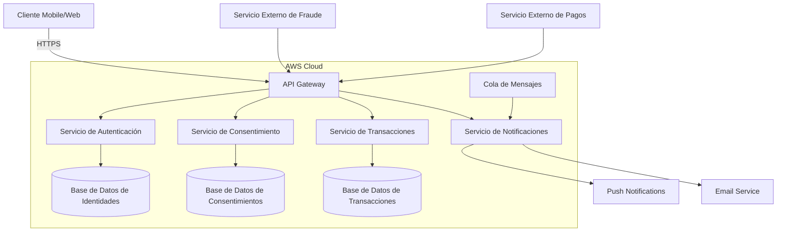

# Arquitectura Propuesta para Integración SOA

## Contexto y Atributos de Calidad

La arquitectura propuesta está diseñada para satisfacer los siguientes atributos de calidad, identificados como críticos para el dominio:

- **Latencia**: Máximo 200ms en aplicaciones móviles.
- **Disponibilidad**: SLA del 99.9%.
- **Escalabilidad**: Capacidad para manejar 10,000 usuarios concurrentes.
- **Resiliencia**: Recuperación automática ante fallos parciales.
- **Seguridad**: Autenticación y autorización robustas (OAuth2, FAPI).

Estos atributos se alinean con los requisitos operativos del negocio y las expectativas de los stakeholders.

## Diagrama de Arquitectura

### Componentes Clave

1. **API Gateway**: 
   - **Responsabilidad**: Enrutamiento de solicitudes, balanceo de carga, limitación de tasa (rate limiting), y terminación TLS.
   - **Tecnología**: AWS API Gateway o Kong.
   - **Justificación**: Centraliza la gestión de tráfico, mejora la seguridad y reduce la latencia mediante caching.

2. **Servicio de Autenticación**:
   - **Responsabilidad**: Validación de identidades y emisión de tokens OAuth2/FAPI.
   - **Tecnología**: AWS Cognito o Keycloak.
   - **Justificación**: Cumple con estándares de seguridad (FAPI) y escalabilidad horizontal.

3. **Servicio de Consentimiento**:
   - **Responsabilidad**: Gestión de consentimientos de usuarios según PSD2/FAPI.
   - **Tecnología**: Microservicio en Node.js o Spring Boot.
   - **Justificación**: Permite auditoría y trazabilidad de consentimientos, crítico para cumplimiento regulatorio.

4. **Servicio de Transacciones**:
   - **Responsabilidad**: Procesamiento de transacciones financieras con validación de fraude.
   - **Tecnología**: Microservicio en Go o Java.
   - **Justificación**: Lenguajes con bajo overhead de latencia y alta concurrencia.

5. **Servicio de Notificaciones**:
   - **Responsabilidad**: Envío de notificaciones push y correos electrónicos.
   - **Tecnología**: AWS SNS + Lambda.
   - **Justificación**: Desacoplamiento mediante colas de mensajes (SQS) para garantizar entrega asíncrona.

6. **Bases de Datos**:
   - **Tecnología**: Amazon Aurora (PostgreSQL) para datos transaccionales, DynamoDB para consentimientos.
   - **Justificación**: Aurora ofrece baja latencia y alta disponibilidad; DynamoDB escala horizontalmente sin esfuerzo.

7. **Cola de Mensajes**:
   - **Tecnología**: Amazon SQS para colas estándar, Amazon EventBridge para eventos.
   - **Justificación**: SQS garantiza entrega al menos una vez y escalabilidad automática.

## Decisiones de Diseño

### 1. **Enfoque SOA con Microservicios**
- **Decisión**: Descomposición en servicios especializados (autenticación, consentimiento, transacciones).
- **Justificación**:
  - **Escalabilidad**: Cada servicio escala independientemente según demanda.
  - **Resiliencia**: Fallos en un servicio no afectan a los demás.
  - **Mantenibilidad**: Equipos pueden trabajar en servicios específicos sin bloquearse.

### 2. **API Gateway como Punto Único de Entrada**
- **Decisión**: Uso de API Gateway para centralizar solicitudes.
- **Justificación**:
  - **Latencia**: Caching de respuestas frecuentes reduce tiempo de respuesta.
  - **Seguridad**: Centraliza autenticación, autorización y validación de esquemas.
  - **Observabilidad**: Métricas y logs unificados para monitoreo.

### 3. **Event-Driven para Notificaciones**
- **Decisión**: Uso de colas de mensajes (SQS) y eventos (EventBridge) para notificaciones.
- **Justificación**:
  - **Disponibilidad**: Desacopla el envío de notificaciones del procesamiento de transacciones.
  - **Escalabilidad**: SQS escala automáticamente bajo carga.
  - **Resiliencia**: Notificaciones no entregadas se reintentan automáticamente.

### 4. **Bases de Datos Especializadas**
- **Decisión**: Aurora para datos transaccionales, DynamoDB para consentimientos.
- **Justificación**:
  - **Latencia**: Aurora optimizado para lecturas/escrituras rápidas.
  - **Escalabilidad**: DynamoDB escala horizontalmente sin downtime.
  - **Costo**: DynamoDB reduce costos operativos para datos poco estructurados.

### 5. **Integración con Servicios Externos**
- **Decisión**: Uso de circuit breakers (AWS Step Functions) para llamadas a servicios externos.
- **Justificación**:
  - **Resiliencia**: Evita cascadas de fallos cuando servicios externos fallan.
  - **Latencia**: Timeouts configurables previenen bloqueos.

## Trade-offs

| Decisión               | Beneficio                          | Compromiso                          |
|------------------------|------------------------------------|-------------------------------------|
| Microservicios        | Escalabilidad y resiliencia       | Complejidad operativa               |
| API Gateway            | Seguridad y observabilidad         | Single point of failure             |
| Aurora + DynamoDB      | Latencia y escalabilidad           | Costos de migración                 |
| Event-Driven           | Desacoplamiento                    | Complejidad en trazabilidad         |
| Circuit Breakers       | Resiliencia                        | Latencia adicional en fallback      |

## Validación de Atributos de Calidad

### Latencia (< 200ms)
- **API Gateway**: Caching de respuestas y balanceo de carga.
- **Microservicios**: Lenguajes de bajo overhead (Go) para procesamiento rápido.
- **Bases de Datos**: Índices optimizados y queries eficientes.

### Disponibilidad (SLA 99.9%)
- **Multi-AZ**: Bases de datos en múltiples zonas de disponibilidad.
- **Retries**: Mecanismos de reintento para fallos transitorios.
- **Health Checks**: Monitoreo proactivo de servicios.

### Escalabilidad (10,000 usuarios concurrentes)
- **Autoscaling**: Microservicios y bases de datos escalan horizontalmente.
- **Colas de Mensajes**: SQS escala automáticamente.
- **Stateless Services**: Permite escalar réplicas sin estado compartido.

### Resiliencia
- **Circuit Breakers**: Para llamadas a servicios externos.
- **Retry Policies**: Para fallos transitorios.
- **Multi-AZ**: Para bases de datos y servicios críticos.

### Seguridad
- **OAuth2/FAPI**: Autenticación y autorización robustas.
- **TLS**: Encriptación en tránsito.
- **IAM**: Políticas de mínimo privilegio para servicios AWS.